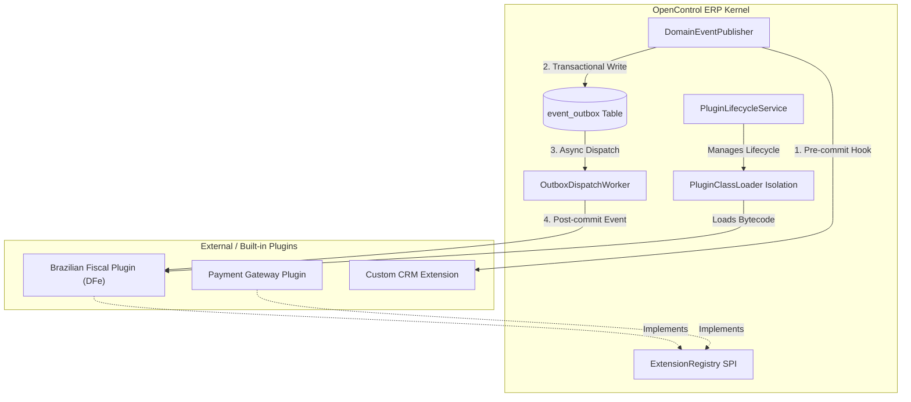
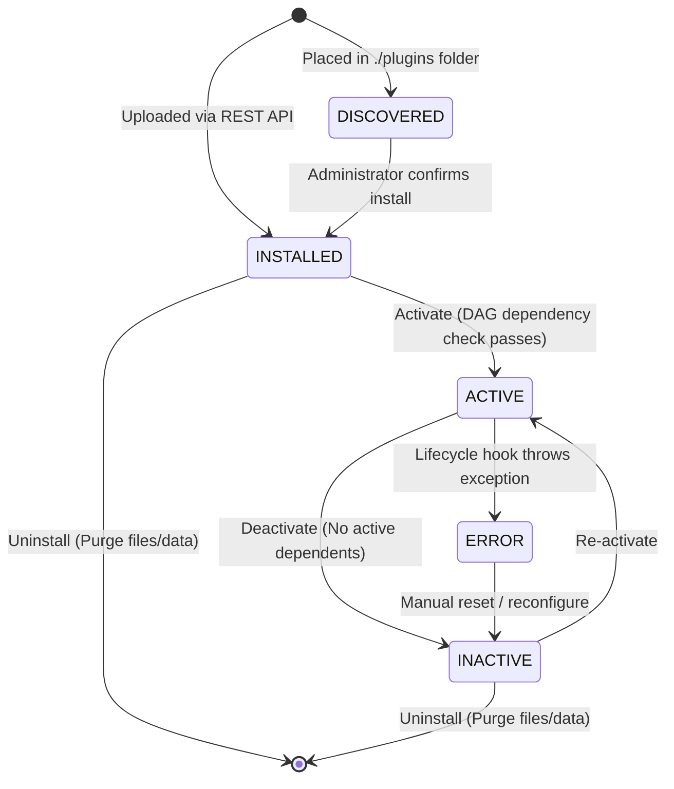

# Architecture & Developer Guide: Extension Engine & Plugin System

> **Feature**: `001-extension-engine`  
> **Status**: Implemented & Ratified  
> **Target Audience**: Core Maintainers, Plugin Developers, and Enterprise Integrators

---

## 1. Architectural Overview

OpenControl ERP is built as an extensible **Modular Monolith**. Rather than requiring developers to fork the kernel or deploy complex distributed microservices, OpenControl provides an in-process **Plugin Runtime Engine** that allows third parties and core developers to load, configure, activate, and deactivate modules (Apps) dynamically.



---

## 2. Plugin Lifecycle & State Machine

Every plugin package managed by OpenControl ERP transitions through a formal, deterministic finite state machine:



### State Definitions
- **`DISCOVERED`**: The archive exists on the filesystem in the configured plugins directory but has not yet been registered into the database.
- **`INSTALLED`**: The package has been unpacked and validated against the manifest schema, dependencies are verified, and metadata is recorded in the `extension_plugin` table.
- **`ACTIVE`**: The plugin's dedicated `PluginClassLoader` is created, SPI implementations are registered in `ExtensionRegistry`, event listeners are bound, and optional `onActivate()` hooks have executed.
- **`INACTIVE`**: The plugin's SPIs are unregistered, event listeners unbound, classloader closed, and resources freed without restarting the application.
- **`ERROR`**: An unhandled exception occurred during the plugin's lifecycle transition. Diagnostics are saved in `error_message`.

---

## 3. Plugin Manifest Specification (`opencontrol-plugin.json`)

Every plugin archive (JAR or ZIP) must contain a manifest descriptor located at `META-INF/opencontrol-plugin.json`.

### Complete Example
```json
{
  "id": "org.opencontrol.fiscal.br",
  "name": "Brazilian Fiscal Compliance (DFe)",
  "version": "1.0.0",
  "vendor": "OpenControl Community",
  "minKernelVersion": "1.0.0",
  "maxKernelVersion": "2.0.0",
  "description": "Statutory SEFAZ electronic invoice issuance (NF-e, NFS-e, MDF-e) for Brazil",
  "entryPointClass": "org.opencontrol.fiscal.br.BrazilFiscalPlugin",
  "dependencies": [
    {
      "pluginId": "org.opencontrol.base",
      "versionRange": ">=1.0.0 <2.0.0",
      "optional": false
    }
  ],
  "extensions": [
    {
      "extensionPoint": "org.opencontrol.erp.fiscal.spi.FiscalEngineSPI",
      "implementationClass": "org.opencontrol.fiscal.br.BrazilianFiscalEngineAdapter",
      "priority": 200,
      "contextConstraints": {
        "jurisdiction": "BR"
      }
    }
  ],
  "eventSubscribers": [
    {
      "eventType": "sales.order.invoiced",
      "subscriberClass": "org.opencontrol.fiscal.br.listener.AutoInvoiceEmitter",
      "mode": "ASYNC_POST_COMMIT"
    }
  ]
}
```

### Manifest Fields
| Field | Type | Required | Description |
|---|---|---|---|
| `id` | String | Yes | Unique reverse-DNS identifier (lowercase, dots allowed). |
| `name` | String | Yes | Human-readable name of the extension. |
| `version` | String | Yes | Semantic version (`MAJOR.MINOR.PATCH`). |
| `vendor` | String | Yes | Author or organization responsible. |
| `minKernelVersion`| String | Yes | Minimum compatible version of OpenControl ERP. |
| `entryPointClass` | String | No | Class implementing `PluginLifecycle` for startup/shutdown logic. |
| `dependencies` | Array | No | Prerequisite plugins that must be active before this plugin can activate. |
| `extensions` | Array | No | SPI implementations provided by this plugin. |
| `eventSubscribers`| Array | No | Domain events subscribed to by this plugin. |

---

## 4. How to Develop an Extension (Step-by-Step)

### Step 1: Create a Gradle Subproject
Configure `build.gradle.kts` for your plugin:

```kotlin
plugins {
    kotlin("jvm") version "2.0.21"
}

dependencies {
    compileOnly("org.opencontrol.erp:opencontrol-kernel:0.1.0-SNAPSHOT")
    // Third party dependencies (e.g., Samuel Oliveira DFe libraries)
    implementation("com.github.samuel-oliveira:java-nfe:4.00.24")
}
```

### Step 2: Implement an SPI Interface
Create your provider implementing an OpenControl SPI:

```kotlin
package org.opencontrol.fiscal.br

import org.opencontrol.erp.fiscal.spi.FiscalEngineSPI
import org.opencontrol.erp.fiscal.spi.FiscalDocumentRequest
import org.opencontrol.erp.fiscal.spi.FiscalIssuanceResult
import org.opencontrol.erp.kernel.spi.ExecutionContext

class BrazilianFiscalEngineAdapter : FiscalEngineSPI {

    override fun matches(context: ExecutionContext): Boolean {
        return context.jurisdiction == "BR"
    }

    override fun issueDocument(request: FiscalDocumentRequest): FiscalIssuanceResult {
        // Integrate with Samuel Oliveira's java-nfe library to transmit XML to SEFAZ
        return FiscalIssuanceResult(
            status = "AUTHORIZED",
            accessKey = "35261100000000000000550010000001011000000010",
            protocolNumber = "135260000000001",
            message = "Autorizado o uso da NF-e"
        )
    }
}
```

### Step 3: Implement Lifecycle Hooks (Optional)
If your plugin needs to initialize background connections or database schemas:

```kotlin
package org.opencontrol.fiscal.br

import org.opencontrol.erp.kernel.plugin.PluginLifecycle
import org.opencontrol.erp.kernel.plugin.PluginContext

class BrazilFiscalPlugin : PluginLifecycle {
    override fun onActivate(context: PluginContext) {
        println("Brazilian Fiscal Engine activated for tenant context.")
    }

    override fun onDeactivate(context: PluginContext) {
        println("Brazilian Fiscal Engine deactivated. Releasing resources.")
    }
}
```

### Step 4: Package into a JAR
Build your plugin archive:
```bash
./gradlew jar
```
The resulting JAR file will contain your compiled classes and `META-INF/opencontrol-plugin.json`.

---

## 5. Service Provider Interface (SPI) Registry

Core business domains (Sales, CRM, Finance) never call concrete vendor libraries directly. Instead, they interact with the **`ExtensionRegistry`**:

```kotlin
// Inside Sales or Invoicing service:
val context = ExecutionContext(tenantId = currentTenantId, jurisdiction = "BR")

// Resolves the highest-priority provider matching jurisdiction="BR"
val fiscalEngine = extensionRegistry.resolve(FiscalEngineSPI::class.java, context)

val result = fiscalEngine.issueDocument(documentRequest)
```

### Contextual Resolution Rules
1. **Context Filtering**: Providers are filtered through `ContextMatcher.matches(context)`.
2. **Priority Precedence**: If multiple plugins match (e.g. Standard Brazil vs. Municipal Customization), the provider with the highest `priority` score is selected.
3. **Graceful Fallback**: If no plugin is active for the requested context, `ExtensionRegistry` resolves the built-in `DefaultNoOpFiscalEngine` to keep workflows operating without hard crashes.

---

## 6. Unified Domain Event Bus & Transactional Outbox

OpenControl ERP uses a **two-tier event pipeline**:

### 1. Synchronous Pre-Commit Interceptors (`PreCommitInterceptor`)
- Executed **inside** the database transaction boundary.
- Used for business validation, fraud checks, or state guards.
- If an interceptor throws an exception, the entire transaction is rolled back.

```kotlin
domainEventPublisher.registerPreCommitInterceptor<OrderPlacedEvent> { event ->
    if (event.totalAmount <= 0) {
        throw PluginValidationException("Orders must have positive value")
    }
}
```

### 2. Asynchronous Post-Commit Outbox (`event_outbox`)
- Published domain events are serialized to JSON and stored in the `event_outbox` table within the same ACID transaction as the business operation.
- The `OutboxDispatchWorker` uses **Java 21 Virtual Threads** to poll pending events and dispatch them to asynchronous plugin listeners.
- **Fault Isolation**: If a plugin subscriber throws an error, the business transaction is **never** undone.
- **Exponential Backoff**: Failed events are retried automatically up to 5 times (`MAX_RETRIES`).
- **Dead-Letter Queue (DLQ)**: Events exceeding max retries are flagged as `DEAD_LETTER` for administrative inspection and manual replay.

---

## 7. Management REST API

All plugin operations can be managed via HTTP REST endpoints (with full Swagger UI support at `/swagger-ui.html`):

| Method | Endpoint | Description |
|---|---|---|
| `GET` | `/api/v1/extensions` | List installed extensions (filter by `?status=ACTIVE`). |
| `POST` | `/api/v1/extensions` | Upload and install a new `.jar` plugin package (multipart/form-data). |
| `GET` | `/api/v1/extensions/{id}` | Inspect details of a specific extension. |
| `POST` | `/api/v1/extensions/{id}/activate` | Activate an installed or inactive extension. |
| `POST` | `/api/v1/extensions/{id}/deactivate` | Deactivate an active extension without JVM restart. |
| `DELETE` | `/api/v1/extensions/{id}` | Uninstall an extension (`?purgeData=true/false`). |
| `GET` | `/api/v1/extensions/events/outbox` | View outbox queue status (`PENDING`, `FAILED`, `DEAD_LETTER`). |
| `POST` | `/api/v1/extensions/events/outbox/{id}/retry` | Force immediate replay of a failed/dead-letter event. |

---

## 8. Auditability & Observability

- **Audit Log**: Every installation, activation, deactivation, and failure generates an immutable record in `extension_audit_log` with user ID, timestamp, and previous/new states.
- **Prometheus Metrics**:
  - `opencontrol.plugins.active.count`: Number of active plugins.
  - `opencontrol.plugins.error.count`: Number of plugins in error state.
  - `opencontrol.events.outbox.pending.count`: Queue depth of pending outbox events.
  - `opencontrol.events.outbox.dead_letter.count`: Unresolved dead-letter events.
