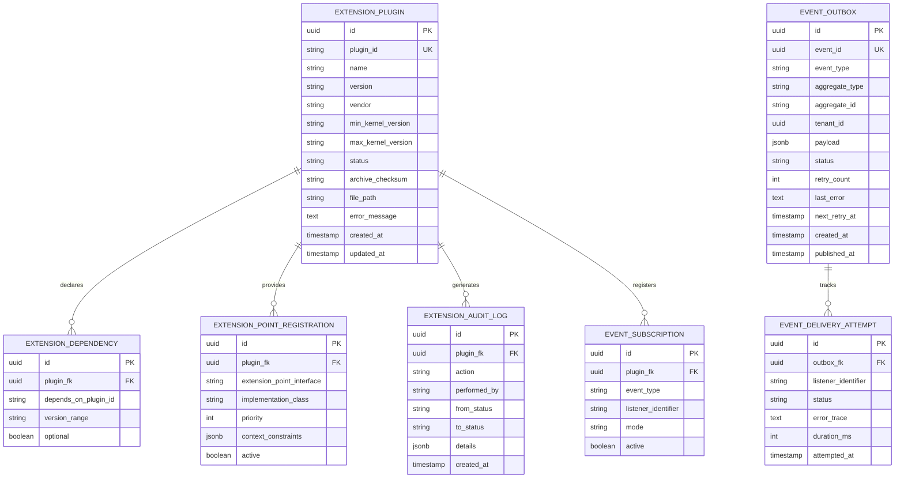
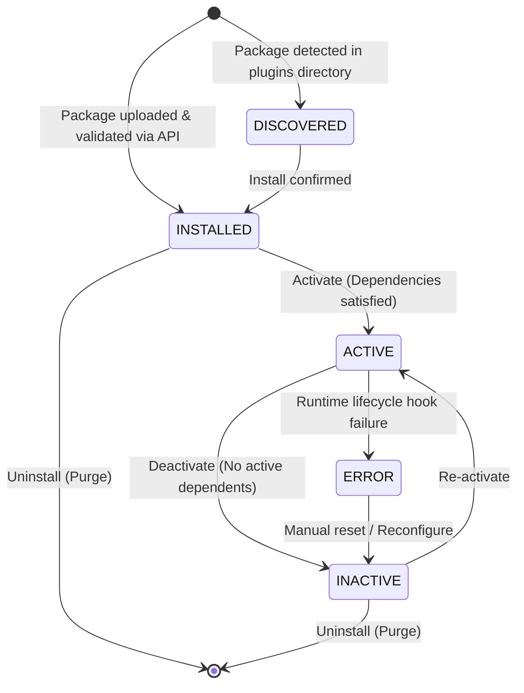

# Data Model: Extension Engine & Event Bus

**Feature**: `001-extension-engine`  
**Date**: 2026-11-01  
**Status**: Completed

## 1. Entity Relationship Overview

---

## 2. Table Specifications & Constraints

### 2.1 `extension_plugin`
Stores registered plugin packages and their runtime state.

| Column | Type | Constraints | Description |
|---|---|---|---|
| `id` | UUID | PRIMARY KEY, NOT NULL | Internal unique identifier |
| `plugin_id` | VARCHAR(120) | UNIQUE, NOT NULL | Standardized reverse-DNS plugin identifier (e.g., `org.opencontrol.fiscal.br`) |
| `name` | VARCHAR(150) | NOT NULL | Human-readable name |
| `description` | TEXT | NULL | Brief description of capabilities |
| `version` | VARCHAR(32) | NOT NULL | Semantic version (e.g., `1.0.0`) |
| `vendor` | VARCHAR(120) | NOT NULL | Organization or author name |
| `min_kernel_version`| VARCHAR(32) | NOT NULL | Minimum supported kernel SemVer |
| `max_kernel_version`| VARCHAR(32) | NULL | Maximum supported kernel SemVer (optional upper bound) |
| `status` | VARCHAR(30) | NOT NULL | `DISCOVERED`, `INSTALLED`, `ACTIVE`, `INACTIVE`, `ERROR` |
| `archive_checksum` | VARCHAR(64) | NULL | SHA-256 hash of the uploaded JAR/ZIP package |
| `file_path` | VARCHAR(500) | NULL | Absolute/relative storage path to the package archive |
| `error_message` | TEXT | NULL | Last failure diagnostics if status = `ERROR` |
| `created_at` | TIMESTAMPTZ | NOT NULL, DEFAULT NOW() | Installation/discovery timestamp |
| `updated_at` | TIMESTAMPTZ | NOT NULL, DEFAULT NOW() | Last state transition timestamp |

### 2.2 `extension_dependency`
Records dependencies required by each extension.

| Column | Type | Constraints | Description |
|---|---|---|---|
| `id` | UUID | PRIMARY KEY, NOT NULL | Internal identifier |
| `plugin_fk` | UUID | FK -> `extension_plugin(id)` ON DELETE CASCADE | Parent plugin |
| `depends_on_plugin_id`| VARCHAR(120) | NOT NULL | Required plugin identifier |
| `version_range` | VARCHAR(64) | NOT NULL | SemVer constraint (e.g., `>=1.2.0 <2.0.0`) |
| `optional` | BOOLEAN | NOT NULL, DEFAULT FALSE | Whether missing dependency blocks activation |

### 2.3 `extension_point_registration`
Tracks available SPI implementations registered by active plugins.

| Column | Type | Constraints | Description |
|---|---|---|---|
| `id` | UUID | PRIMARY KEY, NOT NULL | Unique identifier |
| `plugin_fk` | UUID | FK -> `extension_plugin(id)` ON DELETE CASCADE | Provider plugin |
| `extension_point_interface` | VARCHAR(255) | NOT NULL | Fully qualified SPI class name |
| `implementation_class` | VARCHAR(255) | NOT NULL | Fully qualified implementation class |
| `priority` | INTEGER | NOT NULL, DEFAULT 100 | Resolution weight (higher number = higher precedence) |
| `context_constraints` | JSONB | NULL | Dynamic matching rules (e.g., `{"country": "BR"}`) |
| `active` | BOOLEAN | NOT NULL, DEFAULT TRUE | Active flag toggled by plugin state |

### 2.4 `extension_audit_log`
Immutable record of all administrative actions and lifecycle events.

| Column | Type | Constraints | Description |
|---|---|---|---|
| `id` | UUID | PRIMARY KEY, NOT NULL | Audit log entry ID |
| `plugin_fk` | UUID | FK -> `extension_plugin(id)` ON DELETE SET NULL | Associated plugin |
| `action` | VARCHAR(40) | NOT NULL | `INSTALL`, `ACTIVATE`, `DEACTIVATE`, `UNINSTALL`, `ERROR` |
| `performed_by` | VARCHAR(100) | NOT NULL | Username or system daemon identity |
| `from_status` | VARCHAR(30) | NULL | Initial state before transition |
| `to_status` | VARCHAR(30) | NOT NULL | Target state after transition |
| `details` | JSONB | NULL | Contextual attributes (IP, parameters, payload diff) |
| `created_at` | TIMESTAMPTZ | NOT NULL, DEFAULT NOW() | Event timestamp |

### 2.5 `event_outbox`
Transactional outbox ensuring durable event dispatch across module boundaries.

| Column | Type | Constraints | Description |
|---|---|---|---|
| `id` | UUID | PRIMARY KEY, NOT NULL | Outbox record ID |
| `event_id` | UUID | UNIQUE, NOT NULL | Idempotency event identifier |
| `event_type` | VARCHAR(120) | NOT NULL | Dot-notated domain event type (e.g., `sales.order.created`) |
| `aggregate_type` | VARCHAR(80) | NOT NULL | Origin domain entity/aggregate |
| `aggregate_id` | VARCHAR(80) | NOT NULL | Aggregate entity ID |
| `tenant_id` | UUID | NOT NULL | Multi-tenant organization ID |
| `payload` | JSONB | NOT NULL | Serialized domain event payload |
| `status` | VARCHAR(30) | NOT NULL | `PENDING`, `PROCESSING`, `PUBLISHED`, `FAILED`, `DEAD_LETTER` |
| `retry_count` | INTEGER | NOT NULL, DEFAULT 0 | Number of dispatch attempts |
| `last_error` | TEXT | NULL | Diagnostics from last failure |
| `next_retry_at` | TIMESTAMPTZ | NULL | Next scheduled retry for exponential backoff |
| `created_at` | TIMESTAMPTZ | NOT NULL, DEFAULT NOW() | Outbox creation timestamp |
| `published_at` | TIMESTAMPTZ | NULL | Timestamp of successful publication |

---

## 3. State Machine Transitions

