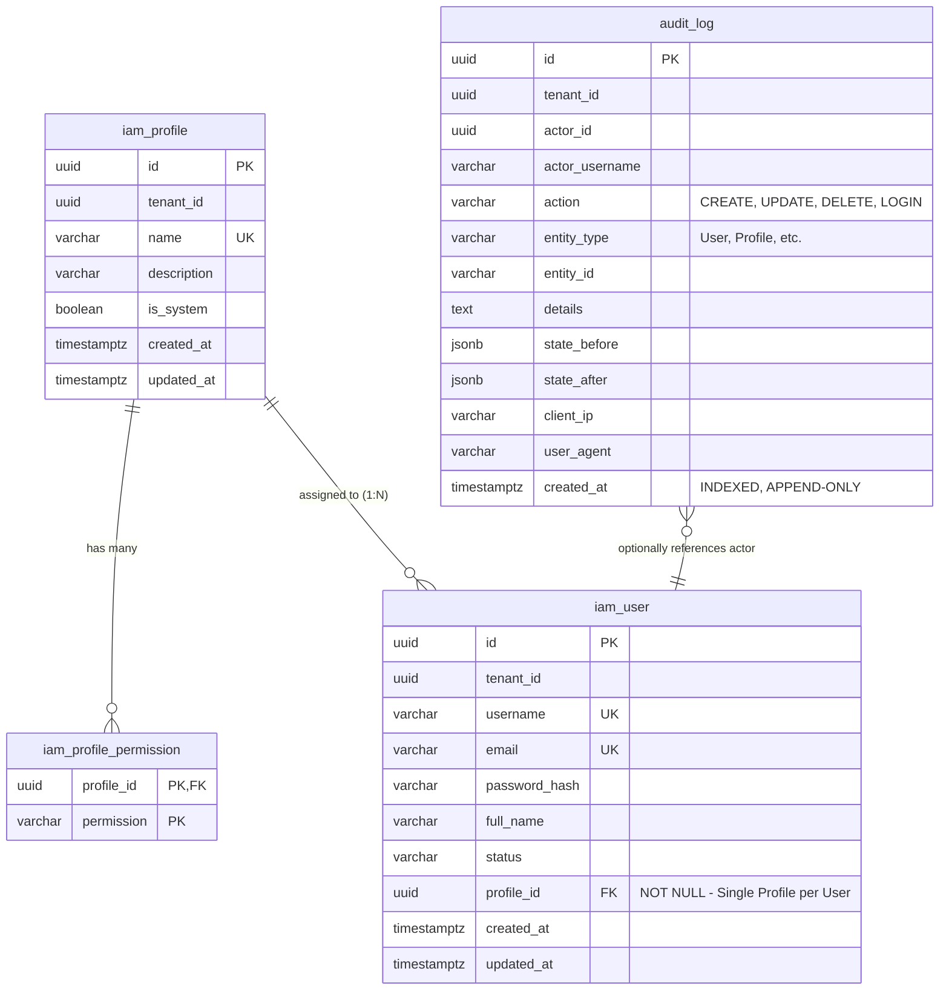

# Data Model: User Management, Access Control (RBAC), and Audit Trail

## 1. Entity-Relationship Overview

---

## 2. Table Definitions & Constraints

### 2.1. `iam_profile`

Defines a role/profile within a tenant containing a collection of enabled permissions.

| Column | Type | Constraints | Description |
|---|---|---|---|
| `id` | `UUID` | `PRIMARY KEY` | Unique profile identifier |
| `tenant_id` | `UUID` | `NOT NULL` | Multi-tenant organization isolation |
| `name` | `VARCHAR(100)` | `NOT NULL` | Profile display name (e.g., "Administrator") |
| `description` | `VARCHAR(255)` | `NULL` | Business explanation of profile duties |
| `is_system` | `BOOLEAN` | `NOT NULL DEFAULT FALSE` | If true, protected from deletion (e.g., Administrator) |
| `created_at` | `TIMESTAMPTZ` | `NOT NULL` | Creation timestamp |
| `updated_at` | `TIMESTAMPTZ` | `NOT NULL` | Last modification timestamp |

- **Indexes & Constraints**:
  - `UNIQUE (tenant_id, name)`: Ensures unique profile names per organization.

---

### 2.2. `iam_profile_permission`

Normalized collection of granular permissions granted to a profile.

| Column | Type | Constraints | Description |
|---|---|---|---|
| `profile_id` | `UUID` | `NOT NULL, FK -> iam_profile(id) ON DELETE CASCADE` | Associated profile |
| `permission` | `VARCHAR(100)` | `NOT NULL` | Standardized permission string (e.g. `USERS_READ`) |

- **Indexes & Constraints**:
  - `PRIMARY KEY (profile_id, permission)`: Prevents duplicate permissions in a profile.

---

### 2.3. `iam_user`

Represents an individual user account with credentials and an enforced single-profile assignment.

| Column | Type | Constraints | Description |
|---|---|---|---|
| `id` | `UUID` | `PRIMARY KEY` | Unique user identifier |
| `tenant_id` | `UUID` | `NOT NULL` | Tenant isolation |
| `username` | `VARCHAR(100)` | `NOT NULL` | Unique login username |
| `email` | `VARCHAR(255)` | `NOT NULL` | Unique contact and login email |
| `password_hash` | `VARCHAR(255)` | `NOT NULL` | BCrypt cryptographic hash |
| `full_name` | `VARCHAR(255)` | `NOT NULL` | User full name |
| `status` | `VARCHAR(30)` | `NOT NULL DEFAULT 'ACTIVE'` | Status (`ACTIVE`, `INACTIVE`, `SUSPENDED`) |
| `profile_id` | `UUID` | `NOT NULL, FK -> iam_profile(id) ON DELETE RESTRICT` | Single assigned profile |
| `created_at` | `TIMESTAMPTZ` | `NOT NULL` | Registration timestamp |
| `updated_at` | `TIMESTAMPTZ` | `NOT NULL` | Last update timestamp |

- **Indexes & Constraints**:
  - `UNIQUE (tenant_id, username)`
  - `UNIQUE (tenant_id, email)`
  - `ON DELETE RESTRICT` on `profile_id`: Strictly prevents deleting a profile while any user is assigned to it.

---

### 2.4. `audit_log`

Immutable audit trail capturing all domain state changes across the ERP.

| Column | Type | Constraints | Description |
|---|---|---|---|
| `id` | `UUID` | `PRIMARY KEY` | Unique audit event identifier |
| `tenant_id` | `UUID` | `NOT NULL` | Organization context |
| `actor_id` | `UUID` | `NULL` | User ID of the actor (null for system jobs) |
| `actor_username` | `VARCHAR(100)` | `NOT NULL` | Username of the actor or `'SYSTEM'` |
| `action` | `VARCHAR(30)` | `NOT NULL` | Mutation action (`CREATE`, `UPDATE`, `DELETE`, `LOGIN`) |
| `entity_type` | `VARCHAR(100)` | `NOT NULL` | Target entity class name (e.g., `'User'`, `'Profile'`) |
| `entity_id` | `VARCHAR(100)` | `NOT NULL` | String representation of entity PK |
| `details` | `TEXT` | `NULL` | Human-readable explanation of the operation |
| `state_before` | `JSONB` | `NULL` | Snapshot of entity before mutation (null for CREATE) |
| `state_after` | `JSONB` | `NULL` | Snapshot of entity after mutation (null for DELETE) |
| `client_ip` | `VARCHAR(45)` | `NULL` | Origin IPv4 or IPv6 address |
| `user_agent` | `VARCHAR(255)` | `NULL` | Browser or client User-Agent |
| `created_at` | `TIMESTAMPTZ` | `NOT NULL` | Exact UTC timestamp of change |

- **Indexes**:
  - `INDEX idx_audit_log_tenant_created (tenant_id, created_at DESC)`: Fast chronological pagination.
  - `INDEX idx_audit_log_entity (tenant_id, entity_type, entity_id)`: Fast filtering by specific business entity.
  - `INDEX idx_audit_log_actor (tenant_id, actor_id, created_at DESC)`: Fast filtering by actor history.
