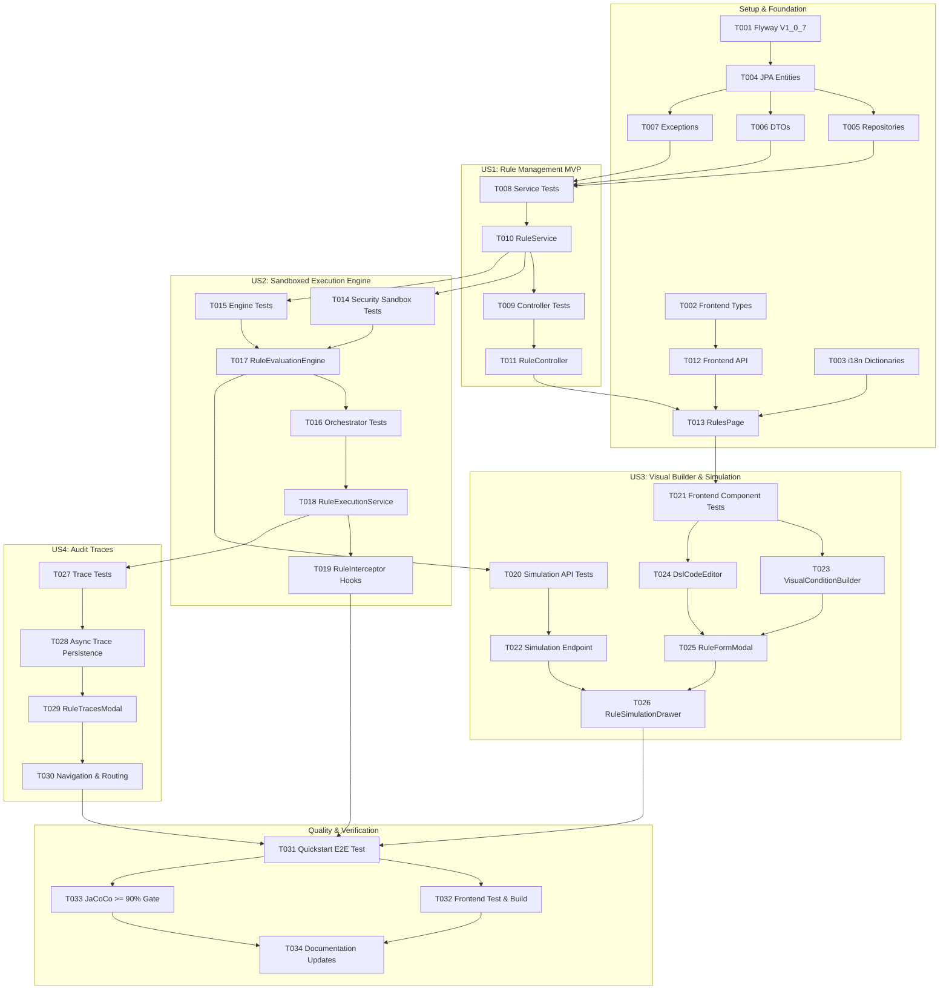

# Tasks: Dynamic Custom Business Rules Engine

**Input**: Design documents from `/specs/004-custom-rules-engine/`  
**Prerequisites**: [plan.md](plan.md), [spec.md](spec.md), [data-model.md](data-model.md), [contracts/custom-rules-api.yaml](contracts/custom-rules-api.yaml), [quickstart.md](quickstart.md), [research.md](research.md)  
**Tests**: Unit, integration, security sandbox, and E2E tests are included per constitution (Principle VII: $\ge 90\%$ JaCoCo coverage gate).

## Format: `- [ ] [TaskID] [P?] [Story?] Description with file path`

- **[P]**: Can run in parallel (different files, no dependencies)
- **[Story]**: Which user story this task belongs to (e.g., US1, US2, US3, US4)
- Explicit file paths included in all tasks

---

## Phase 1: Setup (Shared Infrastructure)

**Purpose**: Database schema migration, TypeScript definitions, and i18n dictionaries.

- [x] T001 Create Flyway database migration `V1_0_7__create_custom_rules_tables.sql` defining `custom_rule` and `rule_execution_trace` tables with multi-tenant indices in `backend/src/main/resources/db/migration/V1_0_7__create_custom_rules_tables.sql`
- [x] T002 [P] Create TypeScript interfaces and types for rules, triggers, timings, authoring modes, failure policies, action types, traces, and simulation payloads in `frontend/src/types/rules.ts`
- [x] T003 [P] Create i18n dictionaries for Custom Rules in `frontend/src/locales/en-US/rules.ts` and `frontend/src/locales/pt-BR/rules.ts` and export through `frontend/src/locales/` index

---

## Phase 2: Foundational (Blocking Prerequisites)

**Purpose**: Core JPA entities, repositories, DTOs, and exception definitions that all user stories depend on.

**⚠️ CRITICAL**: No user story work can begin until this phase is complete.

- [x] T004 Create JPA entities `CustomRule` and `RuleExecutionTrace` with enums (`TriggerPoint`, `RuleTiming`, `AuthoringMode`, `ActionType`, `FailurePolicy`, `TraceResult`) in `backend/src/main/kotlin/org/opencontrol/erp/rules/domain/CustomRule.kt` and `backend/src/main/kotlin/org/opencontrol/erp/rules/domain/RuleExecutionTrace.kt`
- [x] T005 [P] Create Spring Data JPA repositories `CustomRuleRepository` and `RuleExecutionTraceRepository` with tenant isolation queries in `backend/src/main/kotlin/org/opencontrol/erp/rules/repository/CustomRuleRepository.kt` and `backend/src/main/kotlin/org/opencontrol/erp/rules/repository/RuleExecutionTraceRepository.kt`
- [x] T006 [P] Create request/response DTOs (`RuleRequestDto`, `RuleResponseDto`, `RuleSummaryDto`, `RuleSimulationRequestDto`, `RuleSimulationResponseDto`, `RuleTraceResponseDto`) in `backend/src/main/kotlin/org/opencontrol/erp/rules/api/dto/RuleDtos.kt`
- [x] T007 [P] Create domain exceptions (`BusinessRuleViolationException`, `RuleEvaluationException`, `RuleSecurityException`) and controller advice handling in `backend/src/main/kotlin/org/opencontrol/erp/rules/exception/RuleExceptions.kt`

**Checkpoint**: Foundation ready - user story implementation can now begin.

---

## Phase 3: User Story 1 - Create and Manage Tenant-Specific Business Rules (Priority: P1) 🎯 MVP

**Goal**: Enable administrators to configure, view, update, delete, toggle, and filter custom business rules per tenant and lifecycle trigger.

**Independent Test**: Create a rule via `POST /api/v1/rules`, retrieve it via `GET /api/v1/rules`, toggle active status via `PATCH /api/v1/rules/{id}/toggle`, and verify complete tenant isolation between tenants.

### Tests for User Story 1
- [x] T008 [P] [US1] Unit and repository tests for rule CRUD, tenant isolation, and validation logic in `backend/src/test/kotlin/org/opencontrol/erp/rules/service/RuleServiceTest.kt`
- [x] T009 [P] [US1] Controller tests for rule management endpoints (`/api/v1/rules`) in `backend/src/test/kotlin/org/opencontrol/erp/rules/api/RuleControllerTest.kt`

### Implementation for User Story 1
- [x] T010 [US1] Implement `RuleService` for CRUD operations, priority ordering, active toggles, and tenant scope filtering in `backend/src/main/kotlin/org/opencontrol/erp/rules/service/RuleService.kt`
- [x] T011 [US1] Implement `RuleController` exposing `/api/v1/rules` CRUD and toggle endpoints in `backend/src/main/kotlin/org/opencontrol/erp/rules/api/RuleController.kt`
- [x] T012 [P] [US1] Implement frontend API client functions in `frontend/src/api/rulesApi.ts`
- [x] T013 [US1] Implement `RulesPage` management view with search, trigger/timing filters, active toggle switches, and delete confirmations in `frontend/src/pages/RulesPage.tsx`

**Checkpoint**: User Story 1 MVP ready — administrators can manage tenant custom rules via API and web interface.

---

## Phase 4: User Story 2 - Execution Engine with Sandboxing, Timeouts, and Policy-Based Error Handling (Priority: P1)

**Goal**: Execute custom rules in a secure SpEL sandbox with CPU timeouts, recursion guards, and configurable error handling policies (`ABORT_TRANSACTION` vs `LOG_AND_CONTINUE`).

**Independent Test**: Evaluate a rule with `ABORT_TRANSACTION` throwing a violation error that aborts and rolls back a transaction; evaluate a rule with `LOG_AND_CONTINUE` on an unhandled error and verify transaction success with error trace logged. Verify reflection attempts are blocked.

### Tests for User Story 2
- [x] T014 [P] [US2] Security tests verifying strict sandbox denial of `java.lang.Runtime`, `System.exit`, reflection, and unauthorized Spring beans in `backend/src/test/kotlin/org/opencontrol/erp/rules/service/RuleSecuritySandboxTest.kt`
- [x] T015 [P] [US2] Engine evaluation unit tests for SpEL expressions, condition evaluation, and execution timeouts in `backend/src/test/kotlin/org/opencontrol/erp/rules/service/RuleEvaluationEngineTest.kt`
- [x] T016 [P] [US2] Orchestrator integration tests for `ABORT_TRANSACTION` transaction rollback vs `LOG_AND_CONTINUE` permissive logging in `backend/src/test/kotlin/org/opencontrol/erp/rules/service/RuleExecutionServiceTest.kt`

### Implementation for User Story 2
- [x] T017 [US2] Implement `RuleEvaluationEngine` with sandboxed `SimpleEvaluationContext.forReadOnlyDataBinding()` and SpEL expression caching in `backend/src/main/kotlin/org/opencontrol/erp/rules/service/RuleEvaluationEngine.kt`
- [x] T018 [US2] Implement `RuleExecutionService` handling rule sorting, cycle/depth limits ($\le 5$), timeout management, and failure policies in `backend/src/main/kotlin/org/opencontrol/erp/rules/service/RuleExecutionService.kt`
- [x] T019 [US2] Implement `RuleExecutionInterceptor` integrating `BEFORE` rules with domain operations and `@TransactionalEventListener(phase = AFTER_COMMIT)` on Java 21 Virtual Threads for `AFTER` rules in `backend/src/main/kotlin/org/opencontrol/erp/rules/service/RuleInterceptor.kt`

**Checkpoint**: User Stories 1 and 2 operate together: rules execute securely in real domain transactions with strict or permissive error policies.

---

## Phase 5: User Story 3 - Visual No-Code Builder & Interactive Test Simulation (Priority: P2)

**Goal**: Provide a guided Visual Tree Builder for business analysts alongside an Advanced DSL editor, with dry-run test simulation against mock JSON payloads.

**Independent Test**: Open rule modal in `/rules`, configure a condition visually, switch to DSL mode to verify AST sync, enter a mock payload in the Simulation drawer, click "Simulate", and verify output and latency without database mutation.

### Tests for User Story 3
- [x] T020 [P] [US3] Unit and controller tests for simulation endpoint `POST /api/v1/rules/test` in `backend/src/test/kotlin/org/opencontrol/erp/rules/api/RuleSimulationTest.kt`
- [x] T021 [P] [US3] Frontend component tests for Visual Condition Builder, DSL Editor, and Simulation Drawer in `frontend/src/pages/__tests__/RulesPage.test.tsx`

### Implementation for User Story 3
- [x] T022 [US3] Implement dry-run simulation endpoint `POST /api/v1/rules/test` in `backend/src/main/kotlin/org/opencontrol/erp/rules/api/RuleController.kt` and `RuleExecutionService.kt`
- [x] T023 [P] [US3] Implement `VisualConditionBuilder` component with entity property pickers, operator dropdowns, and value inputs in `frontend/src/components/rules/VisualConditionBuilder.tsx`
- [x] T024 [P] [US3] Implement `DslCodeEditor` component with syntax checking, helper chips, and validation feedback in `frontend/src/components/rules/DslCodeEditor.tsx`
- [x] T025 [P] [US3] Implement `RuleFormModal` coordinating Visual and DSL tabs with bi-directional AST conversion in `frontend/src/components/rules/RuleFormModal.tsx`
- [x] T026 [US3] Implement `RuleSimulationDrawer` with sample payload editor, simulate action, and detailed outcome inspection in `frontend/src/components/rules/RuleSimulationDrawer.tsx`

**Checkpoint**: Users can visually construct rules or write DSL expressions and dry-run test them in the browser before saving.

---

## Phase 6: User Story 4 - Rule Execution Audit and Traceability (Priority: P2)

**Goal**: Capture execution traces (`rule_execution_trace`) for all executed rules and provide an audit explorer drawer to inspect which rules fired, their latency, and error diagnostics.

**Independent Test**: Trigger operations with active rules, verify asynchronous trace logging, query `GET /api/v1/rules/traces`, open the Traces Drawer in the UI, and verify trace details and execution durations.

### Tests for User Story 4
- [x] T027 [P] [US4] Tests for asynchronous trace logging and multi-tenant trace pagination in `backend/src/test/kotlin/org/opencontrol/erp/rules/service/RuleExecutionTraceTest.kt`

### Implementation for User Story 4
- [x] T028 [US4] Implement asynchronous trace recording on Java 21 Virtual Threads and query endpoint `GET /api/v1/rules/traces` in `backend/src/main/kotlin/org/opencontrol/erp/rules/service/RuleExecutionService.kt` and `RuleController.kt`
- [x] T029 [P] [US4] Implement `RuleTracesModal` / Drawer showing chronological executions, statuses (`MATCHED`, `SKIPPED`, `ERROR`), and duration in `frontend/src/components/rules/RuleTracesModal.tsx`
- [x] T030 [US4] Add navigation item for `/rules` in AppLayout with localized labels in `frontend/src/components/layout/AppLayout.tsx` and register route in `frontend/src/App.tsx`

**Checkpoint**: Complete observability established — administrators can diagnose rule behavior in real-time.

---

## Phase 7: Polish & Cross-Cutting Concerns

**Purpose**: System bootstrap, end-to-end integration validation, test coverage enforcement, and documentation.

- [x] T031 [P] Execute quickstart scenarios in an automated end-to-end integration test in `backend/src/test/kotlin/org/opencontrol/erp/rules/QuickstartRulesEngineEndToEndTest.kt`
- [x] T032 [P] Run frontend test suite (`npm test`) and production bundle build (`npm run build`) in `frontend/`
- [x] T033 [P] Verify JaCoCo $\ge 90\%$ test coverage verification across all new/modified packages in `backend/build.gradle.kts`
- [x] T034 [P] Update backend and frontend architectural documentation in `backend/README.md` and `frontend/README.md`

---

## Dependencies & Execution Order

