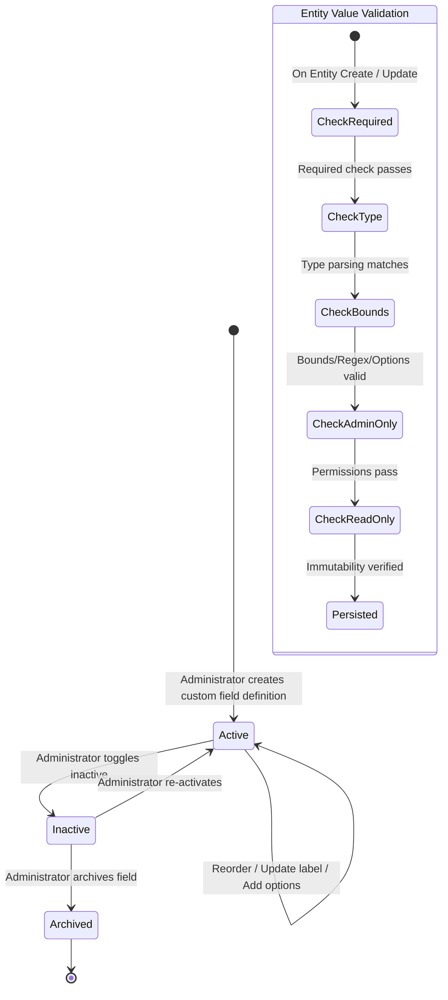

# Data Model: Dynamic Custom Fields Engine

**Feature**: `005-custom-fields`
**Date**: 2026-11-02

## 1. Relational Entities & Schema

### `custom_field_definitions`
Stores tenant-specific custom field schemas and metadata associated with target business entities.

```sql
CREATE TABLE custom_field_definitions (
    id UUID PRIMARY KEY DEFAULT gen_random_uuid(),
    tenant_id UUID NOT NULL,
    target_entity VARCHAR(64) NOT NULL,
    field_key VARCHAR(64) NOT NULL,
    label VARCHAR(128) NOT NULL,
    description VARCHAR(255),
    field_type VARCHAR(32) NOT NULL, -- 'TEXT', 'NUMBER', 'DECIMAL', 'DATE', 'BOOLEAN', 'SELECT'
    required BOOLEAN NOT NULL DEFAULT FALSE,
    admin_only BOOLEAN NOT NULL DEFAULT FALSE,
    read_only BOOLEAN NOT NULL DEFAULT FALSE,
    default_value VARCHAR(255),
    options JSONB, -- For SELECT types, e.g. ["RETAIL", "WHOLESALE", "ENTERPRISE"]
    validation_rules JSONB, -- E.g. {"min": 0, "max": 1000, "regex": "^[A-Z0-9]+$"}
    display_order INT NOT NULL DEFAULT 0,
    is_active BOOLEAN NOT NULL DEFAULT TRUE,
    created_at TIMESTAMP WITH TIME ZONE NOT NULL DEFAULT NOW(),
    updated_at TIMESTAMP WITH TIME ZONE NOT NULL DEFAULT NOW(),
    CONSTRAINT uk_tenant_entity_field_key UNIQUE (tenant_id, target_entity, field_key)
);

CREATE INDEX idx_custom_field_defs_lookup 
    ON custom_field_definitions (tenant_id, target_entity, is_active, display_order);
```

### `entity_custom_fields`
Stores the concrete custom field key-value pairs for any entity instance in the system, decoupled from the core entity table.

```sql
CREATE TABLE entity_custom_fields (
    id UUID PRIMARY KEY DEFAULT gen_random_uuid(),
    tenant_id UUID NOT NULL,
    target_entity VARCHAR(64) NOT NULL,
    entity_id UUID NOT NULL,
    field_values JSONB NOT NULL DEFAULT '{}'::jsonb,
    created_at TIMESTAMP WITH TIME ZONE NOT NULL DEFAULT NOW(),
    updated_at TIMESTAMP WITH TIME ZONE NOT NULL DEFAULT NOW(),
    CONSTRAINT uk_tenant_target_entity_record UNIQUE (tenant_id, target_entity, entity_id)
);

CREATE INDEX idx_entity_custom_fields_lookup 
    ON entity_custom_fields (tenant_id, target_entity, entity_id);

CREATE INDEX idx_entity_custom_fields_gin 
    ON entity_custom_fields USING GIN (field_values);
```

---

## 2. Enums and Domain Value Objects

### `FieldType`
Enum representing supported field data types:
- `TEXT`: Single or multi-line string.
- `NUMBER`: Integer numbers.
- `DECIMAL`: Numbers with decimal places.
- `DATE`: ISO Date (`YYYY-MM-DD`).
- `BOOLEAN`: Boolean true/false.
- `SELECT`: Single choice from an enumerated list of options.

### `TargetEntityDescriptor`
Descriptor defining an entity capable of receiving custom fields:
- `entityCode`: String (`CUSTOMER`, `SUPPLIER`, `PRODUCT`, etc.)
- `displayName`: String (e.g. "Customer")
- `module`: String (e.g. "CRM", "CATALOG", "INVENTORY")
- `description`: String

### `CustomFieldValidationRules`
DTO capturing validation constraints:
- `min`: Optional Double/Long (minimum numeric value or character length)
- `max`: Optional Double/Long (maximum numeric value or character length)
- `regex`: Optional String (regular expression for text validation)
- `allowedOptions`: Optional List<String> (for `SELECT` type)

---

## 3. State & Validation Transitions


