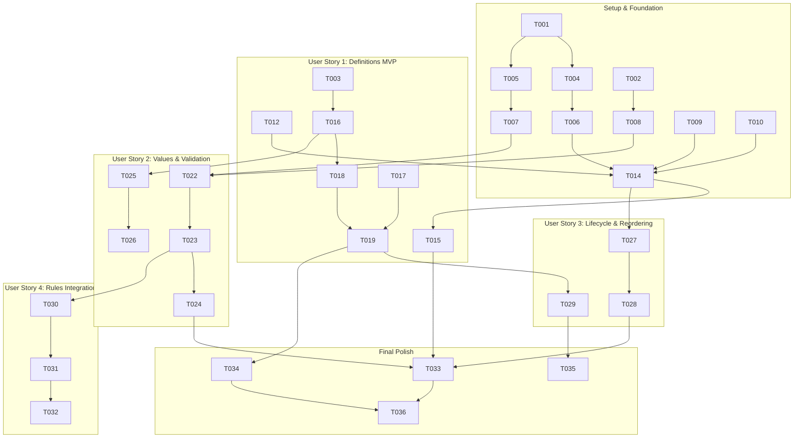

# Tasks: Dynamic Custom Fields Engine for Business Entities

**Input**: Design documents from `specs/005-custom-fields/`
**Prerequisites**: `plan.md`, `spec.md`, `research.md`, `data-model.md`, `contracts/custom-fields-api.yaml`, `quickstart.md`
**Tests**: Automated unit, integration, and E2E tests are included to guarantee Constitution Principle VII ($\ge 90\%$ JaCoCo test coverage gate).
**Organization**: Tasks are grouped by user story to enable independent implementation and testing.

## Format: `- [x] [TaskID] [P?] [Story] Description with file path`

- **[P]**: Can run in parallel (different files, no conflicting dependencies)
- **[Story]**: User story identifier ([US1], [US2], [US3], [US4])

---

## Phase 1: Setup (Shared Infrastructure)

**Purpose**: Database schema, domain enums, and shared contracts

- [x] T001 Create Flyway database migration script in `backend/src/main/resources/db/migration/V1_0_8__create_custom_fields_tables.sql` creating `custom_field_definitions` and `entity_custom_fields` with indexes and unique constraints
- [x] T002 [P] Define domain enums (`FieldType`: TEXT, NUMBER, DECIMAL, DATE, BOOLEAN, SELECT) and validation value objects in `backend/src/main/kotlin/org/opencontrol/erp/customfields/domain/CustomFieldEnums.kt`
- [x] T003 [P] Define TypeScript interfaces, enums, and API models in `frontend/src/types/customFields.ts`

---

## Phase 2: Foundational (Blocking Prerequisites)

**Purpose**: Core JPA entities, repositories, exceptions, and entity registry SPI

**⚠️ CRITICAL**: Must complete before user story business logic is implemented

- [x] T004 [P] Implement `CustomFieldDefinition` JPA entity with tenant isolation in `backend/src/main/kotlin/org/opencontrol/erp/customfields/domain/CustomFieldDefinition.kt`
- [x] T005 [P] Implement `EntityCustomFields` JPA entity with JSONB value mapping in `backend/src/main/kotlin/org/opencontrol/erp/customfields/domain/EntityCustomFields.kt`
- [x] T006 [P] Create `CustomFieldDefinitionRepository` with tenant-scoped queries in `backend/src/main/kotlin/org/opencontrol/erp/customfields/repository/CustomFieldDefinitionRepository.kt`
- [x] T007 [P] Create `EntityCustomFieldsRepository` with tenant-scoped lookup in `backend/src/main/kotlin/org/opencontrol/erp/customfields/repository/EntityCustomFieldsRepository.kt`
- [x] T008 [P] Define domain exceptions (`CustomFieldNotFoundException`, `DuplicateFieldKeyException`, `InvalidFieldValueException`, `FieldSecurityException`) in `backend/src/main/kotlin/org/opencontrol/erp/customfields/exception/CustomFieldExceptions.kt`
- [x] T009 [P] Implement `CustomFieldEntityRegistry` SPI in `backend/src/main/kotlin/org/opencontrol/erp/customfields/service/CustomFieldEntityRegistry.kt` registering `CUSTOMER`, `SUPPLIER`, and `PRODUCT`
- [x] T010 Add `CUSTOM_FIELDS_READ` and `CUSTOM_FIELDS_MANAGE` permissions to `backend/src/main/kotlin/org/opencontrol/erp/iam/domain/Permission.kt` and update `backend/src/test/kotlin/org/opencontrol/erp/iam/service/ProfileServiceTest.kt`

---

## Phase 3: User Story 1 - Define Custom Fields per Business Entity (Priority: P1) 🎯 MVP

**Goal**: Tenant administrators can define custom fields for registered entities with labels, types, validation rules, and display orders.
**Independent Test**: Create field definitions via API and frontend modal, confirm persistence in catalog, and verify duplicate key rejection.

### Tests for User Story 1
- [x] T011 [P] [US1] Unit tests for definition creation, listing, and validation in `backend/src/test/kotlin/org/opencontrol/erp/customfields/service/CustomFieldDefinitionServiceTest.kt`
- [x] T012 [P] [US1] Controller tests for definition REST endpoints in `backend/src/test/kotlin/org/opencontrol/erp/customfields/api/CustomFieldControllerTest.kt`

### Implementation for User Story 1
- [x] T013 [US1] Create API DTOs (`CreateCustomFieldDefinitionRequest`, `UpdateCustomFieldDefinitionRequest`, `CustomFieldDefinitionResponse`, `TargetEntityDescriptor`) in `backend/src/main/kotlin/org/opencontrol/erp/customfields/api/dto/CustomFieldDtos.kt`
- [x] T014 [US1] Implement `CustomFieldDefinitionService` in `backend/src/main/kotlin/org/opencontrol/erp/customfields/service/CustomFieldDefinitionService.kt` for creating and listing definitions
- [x] T015 [US1] Implement REST endpoints (`GET /entities`, `GET /definitions`, `POST /definitions`) in `backend/src/main/kotlin/org/opencontrol/erp/customfields/api/CustomFieldController.kt`
- [x] T016 [P] [US1] Implement frontend API client in `frontend/src/api/customFieldsApi.ts`
- [x] T017 [P] [US1] Create i18n dictionary entries for custom fields in `frontend/src/locales/en-US/customFields.ts` and `frontend/src/locales/pt-BR/customFields.ts` and export in index files
- [x] T018 [US1] Build `CustomFieldDefinitionModal.tsx` in `frontend/src/components/customFields/CustomFieldDefinitionModal.tsx` with field type picker, options editor, and required/admin/read-only toggles
- [x] T019 [US1] Build `CustomFieldsSettingsPage.tsx` in `frontend/src/pages/CustomFieldsSettingsPage.tsx` with entity tabs and field listing, and register route in `frontend/src/App.tsx`

**Checkpoint**: User Story 1 MVP is fully operational. Administrators can create and list custom field schemas per entity.

---

## Phase 4: User Story 2 - Fill and Validate Custom Fields on Entity Records (Priority: P1)

**Goal**: Operators can input custom field values on entities, with strict type validation, bounds checks, option matching, and role flag enforcement.
**Independent Test**: Submit valid and invalid payloads for entity custom values; verify validation error messages and accurate value retrieval.

### Tests for User Story 2
- [x] T020 [P] [US2] Unit tests for validation engine in `backend/src/test/kotlin/org/opencontrol/erp/customfields/service/CustomFieldValidatorTest.kt`
- [x] T021 [P] [US2] Unit tests for value persistence and security filtering in `backend/src/test/kotlin/org/opencontrol/erp/customfields/service/CustomFieldValueServiceTest.kt`

### Implementation for User Story 2
- [x] T022 [US2] Implement `CustomFieldValidator` in `backend/src/main/kotlin/org/opencontrol/erp/customfields/service/CustomFieldValidator.kt` validating TEXT, NUMBER, DECIMAL, DATE, BOOLEAN, SELECT, regex, min/max, and required rules
- [x] T023 [US2] Implement `CustomFieldValueService` in `backend/src/main/kotlin/org/opencontrol/erp/customfields/service/CustomFieldValueService.kt` handling value persistence, JSONB formatting, `adminOnly` security stripping, and `readOnly` immutability
- [x] T024 [US2] Implement value REST endpoints (`GET /values/{targetEntity}/{entityId}`, `PUT /values/{targetEntity}/{entityId}`) in `backend/src/main/kotlin/org/opencontrol/erp/customfields/api/CustomFieldController.kt`
- [x] T025 [P] [US2] Create reusable form component `CustomFieldFormSection.tsx` in `frontend/src/components/customFields/CustomFieldFormSection.tsx` rendering dynamic inputs with validation messages
- [x] T026 [P] [US2] Create reusable summary card `CustomFieldDisplayCard.tsx` in `frontend/src/components/customFields/CustomFieldDisplayCard.tsx` for read-only entity detail views

**Checkpoint**: User Stories 1 AND 2 are fully operational. Entities can store, validate, and display custom fields seamlessly.

---

## Phase 5: User Story 3 - Manage Lifecycle and Reordering of Custom Fields (Priority: P2)

**Goal**: Administrators can update field labels, reorder presentation sequence, and toggle active/inactive status without breaking historical data.
**Independent Test**: Deactivate a field and verify it hides from new entry forms while old records retain values; reorder fields and verify display sequence updates.

### Implementation for User Story 3
- [x] T027 [US3] Implement field definition update, status toggle (`PATCH /definitions/{id}/toggle-status`), and reordering logic (`PUT /definitions/reorder`) in `backend/src/main/kotlin/org/opencontrol/erp/customfields/service/CustomFieldDefinitionService.kt`
- [x] T028 [US3] Expose update, status toggle, and reorder endpoints in `backend/src/main/kotlin/org/opencontrol/erp/customfields/api/CustomFieldController.kt`
- [x] T029 [US3] Add status toggle switches and reordering controls (move up/down) in `frontend/src/pages/CustomFieldsSettingsPage.tsx`

**Checkpoint**: User Stories 1, 2, and 3 work harmoniously. Field schema lifecycles are fully manageable.

---

## Phase 6: User Story 4 - Consume Custom Fields in Business Rules and Automations (Priority: P3)

**Goal**: Expose custom field values to the SpEL Custom Rules Engine condition evaluation context.
**Independent Test**: Create and evaluate a rule with condition `#customer.customFields['spouse_name'] != null` and verify successful evaluation.

### Implementation for User Story 4
- [x] T030 [P] [US4] Update entity context builder in `backend/src/main/kotlin/org/opencontrol/erp/rules/service/RuleEvaluationEngine.kt` to merge custom field key-value pairs into the SpEL evaluation context map
- [x] T031 [US4] Add custom fields detection and schema hints to `frontend/src/types/entityFields.ts` so dynamic fields are available in the visual rule builder
- [x] T032 [P] [US4] Add integration test in `backend/src/test/kotlin/org/opencontrol/erp/rules/CustomFieldRuleIntegrationTest.kt` verifying SpEL rule execution on custom fields

---

## Phase 7: Polish & Cross-Cutting Concerns

**Purpose**: End-to-end integration tests, navigation links, and code coverage verification

- [x] T033 Create end-to-end integration test `QuickstartCustomFieldsEndToEndTest.kt` in `backend/src/test/kotlin/org/opencontrol/erp/customfields/QuickstartCustomFieldsEndToEndTest.kt` verifying all scenarios in `quickstart.md`
- [x] T034 [P] Create frontend unit tests `CustomFieldsSettingsPage.test.tsx` in `frontend/src/pages/__tests__/CustomFieldsSettingsPage.test.tsx`
- [x] T035 Add Custom Fields navigation item in `frontend/src/components/layout/AppLayout.tsx` under Settings
- [x] T036 Run code formatting and verify test coverage gate (`./gradlew spotlessApply test jacocoTestCoverageVerification; npm --prefix frontend test -- --run`)

---

## Dependencies & Execution Order

### Parallel Opportunities

- **Phase 1 & 2**: T002, T003, T004, T005, T006, T007, T008 can be authored in parallel.
- **Phase 3 (US1)**: Backend tests T011 and T012 can be implemented alongside DTOs T013; Frontend T016 and T017 can be authored while backend is being built.
- **Phase 4 (US2)**: T020 and T021 tests in parallel; T025 and T026 frontend components in parallel.
- **Phase 7**: T033 and T034 tests in parallel.

### Implementation Strategy

- **MVP Scope**: Phases 1, 2, and 3 (Tasks T001 to T019) establish the foundational schema and complete User Story 1 (Admin can configure and list custom fields per entity).
- **Incremental Value**: Phase 4 delivers value storage and dynamic forms; Phase 5 adds reordering and active/inactive toggle; Phase 6 integrates with SpEL rules engine.
