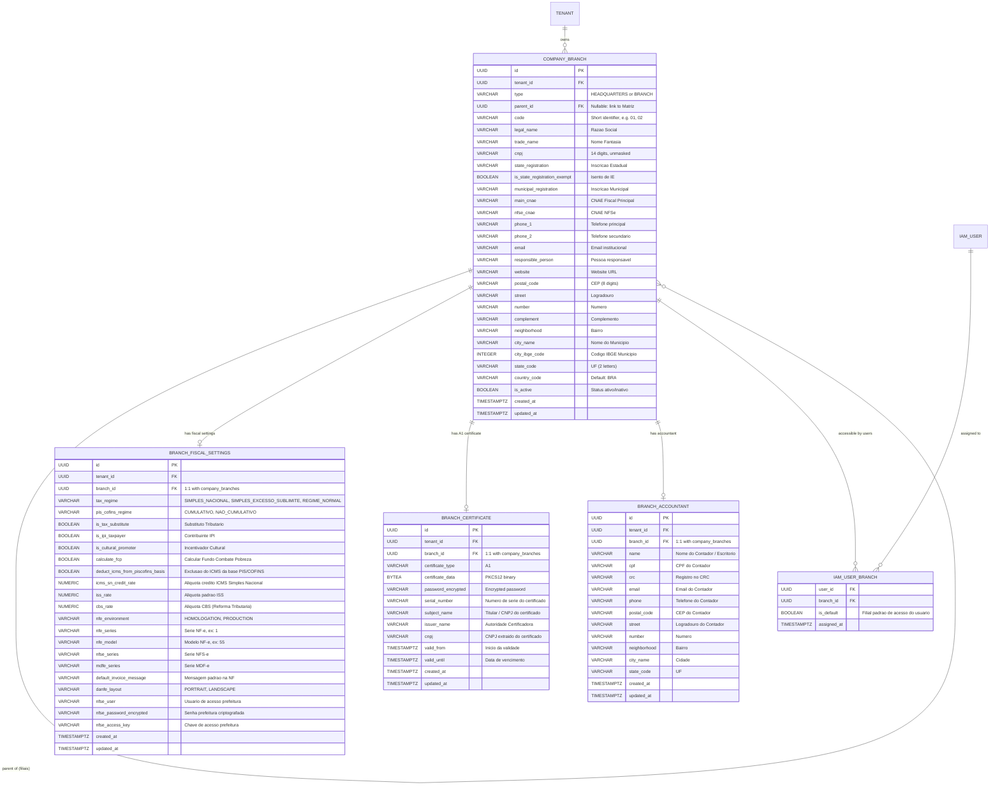

# Data Model: Company & Branch Management (Cadastro de Empresas e Filiais)

**Feature**: `006-company-branches`
**Date**: 2026-11-02

## 1. Entity-Relationship Overview



---

## 2. Relational Schema Details & Flyway Migration Plan

Migration script: `V1_0_9__create_company_branches_tables.sql`

```sql
-- 1. Company and Branches (Unified Table)
CREATE TABLE company_branches (
    id UUID PRIMARY KEY DEFAULT gen_random_uuid(),
    tenant_id UUID NOT NULL,
    type VARCHAR(30) NOT NULL DEFAULT 'HEADQUARTERS', -- 'HEADQUARTERS', 'BRANCH'
    parent_id UUID REFERENCES company_branches(id) ON DELETE RESTRICT,
    code VARCHAR(20) NOT NULL,
    legal_name VARCHAR(150) NOT NULL,
    trade_name VARCHAR(150) NOT NULL,
    cnpj VARCHAR(14) NOT NULL,
    state_registration VARCHAR(30),
    is_state_registration_exempt BOOLEAN NOT NULL DEFAULT FALSE,
    municipal_registration VARCHAR(30),
    main_cnae VARCHAR(20),
    nfse_cnae VARCHAR(20),
    phone_1 VARCHAR(30),
    phone_2 VARCHAR(30),
    email VARCHAR(100),
    responsible_person VARCHAR(100),
    website VARCHAR(200),
    postal_code VARCHAR(10),
    street VARCHAR(150),
    number VARCHAR(30),
    complement VARCHAR(100),
    neighborhood VARCHAR(100),
    city_name VARCHAR(100) NOT NULL,
    city_ibge_code INTEGER,
    state_code VARCHAR(2) NOT NULL,
    country_code VARCHAR(3) NOT NULL DEFAULT 'BRA',
    is_active BOOLEAN NOT NULL DEFAULT TRUE,
    created_at TIMESTAMPTZ NOT NULL DEFAULT NOW(),
    updated_at TIMESTAMPTZ NOT NULL DEFAULT NOW(),
    CONSTRAINT uq_company_branch_tenant_cnpj UNIQUE (tenant_id, cnpj),
    CONSTRAINT uq_company_branch_tenant_code UNIQUE (tenant_id, code)
);

CREATE INDEX idx_company_branches_tenant ON company_branches(tenant_id);
CREATE INDEX idx_company_branches_parent ON company_branches(parent_id);
CREATE INDEX idx_company_branches_cnpj ON company_branches(cnpj);

-- 2. Branch Fiscal Settings (1:1 with company_branches)
CREATE TABLE branch_fiscal_settings (
    id UUID PRIMARY KEY DEFAULT gen_random_uuid(),
    tenant_id UUID NOT NULL,
    branch_id UUID NOT NULL UNIQUE REFERENCES company_branches(id) ON DELETE CASCADE,
    tax_regime VARCHAR(50) NOT NULL DEFAULT 'SIMPLES_NACIONAL',
    pis_cofins_regime VARCHAR(50) NOT NULL DEFAULT 'CUMULATIVO',
    is_tax_substitute BOOLEAN NOT NULL DEFAULT FALSE,
    is_ipi_taxpayer BOOLEAN NOT NULL DEFAULT FALSE,
    is_cultural_promoter BOOLEAN NOT NULL DEFAULT FALSE,
    calculate_fcp BOOLEAN NOT NULL DEFAULT FALSE,
    deduct_icms_from_piscofins_basis BOOLEAN NOT NULL DEFAULT TRUE,
    icms_sn_credit_rate NUMERIC(7, 3) DEFAULT 0.000,
    iss_rate NUMERIC(7, 3) DEFAULT 0.000,
    cbs_rate NUMERIC(7, 3) DEFAULT 0.000,
    nfe_environment VARCHAR(20) NOT NULL DEFAULT 'HOMOLOGATION',
    nfe_series VARCHAR(10) DEFAULT '1',
    nfe_model VARCHAR(5) DEFAULT '55',
    nfse_series VARCHAR(10),
    mdfe_series VARCHAR(10),
    default_invoice_message VARCHAR(1000),
    danfe_layout VARCHAR(20) DEFAULT 'PORTRAIT',
    nfse_user VARCHAR(100),
    nfse_password_encrypted VARCHAR(255),
    nfse_access_key VARCHAR(100),
    created_at TIMESTAMPTZ NOT NULL DEFAULT NOW(),
    updated_at TIMESTAMPTZ NOT NULL DEFAULT NOW()
);

CREATE INDEX idx_branch_fiscal_tenant ON branch_fiscal_settings(tenant_id);

-- 3. Branch Digital Certificates (A1)
CREATE TABLE branch_certificates (
    id UUID PRIMARY KEY DEFAULT gen_random_uuid(),
    tenant_id UUID NOT NULL,
    branch_id UUID NOT NULL UNIQUE REFERENCES company_branches(id) ON DELETE CASCADE,
    certificate_type VARCHAR(10) NOT NULL DEFAULT 'A1',
    certificate_data BYTEA NOT NULL,
    password_encrypted VARCHAR(255) NOT NULL,
    serial_number VARCHAR(100),
    subject_name VARCHAR(255),
    issuer_name VARCHAR(255),
    cnpj VARCHAR(14),
    valid_from TIMESTAMPTZ,
    valid_until TIMESTAMPTZ NOT NULL,
    created_at TIMESTAMPTZ NOT NULL DEFAULT NOW(),
    updated_at TIMESTAMPTZ NOT NULL DEFAULT NOW()
);

CREATE INDEX idx_branch_certificates_tenant ON branch_certificates(tenant_id);
CREATE INDEX idx_branch_certificates_expiry ON branch_certificates(valid_until);

-- 4. Branch Accountants
CREATE TABLE branch_accountants (
    id UUID PRIMARY KEY DEFAULT gen_random_uuid(),
    tenant_id UUID NOT NULL,
    branch_id UUID NOT NULL UNIQUE REFERENCES company_branches(id) ON DELETE CASCADE,
    name VARCHAR(150) NOT NULL,
    cpf VARCHAR(14),
    crc VARCHAR(30),
    email VARCHAR(100),
    phone VARCHAR(30),
    postal_code VARCHAR(10),
    street VARCHAR(150),
    number VARCHAR(30),
    neighborhood VARCHAR(100),
    city_name VARCHAR(100),
    state_code VARCHAR(2),
    created_at TIMESTAMPTZ NOT NULL DEFAULT NOW(),
    updated_at TIMESTAMPTZ NOT NULL DEFAULT NOW()
);

CREATE INDEX idx_branch_accountants_tenant ON branch_accountants(tenant_id);

-- 5. User-to-Branch Mapping (Many-to-Many with default indicator)
CREATE TABLE iam_user_branch (
    user_id UUID NOT NULL REFERENCES iam_user(id) ON DELETE CASCADE,
    branch_id UUID NOT NULL REFERENCES company_branches(id) ON DELETE CASCADE,
    is_default BOOLEAN NOT NULL DEFAULT FALSE,
    assigned_at TIMESTAMPTZ NOT NULL DEFAULT NOW(),
    PRIMARY KEY (user_id, branch_id)
);

CREATE INDEX idx_iam_user_branch_user ON iam_user_branch(user_id);
CREATE INDEX idx_iam_user_branch_branch ON iam_user_branch(branch_id);
```

---

## 3. Domain Enums

### `EstablishmentType`
- `HEADQUARTERS`: Matriz (primary legal identity, root of branch tree).
- `BRANCH`: Filial (operational establishment, store, warehouse, factory).

### `TaxRegime` (Código de Regime Tributário - CRT)
- `SIMPLES_NACIONAL` (CRT 1)
- `SIMPLES_EXCESSO_SUBLIMITE` (CRT 2)
- `REGIME_NORMAL` (CRT 3 - Lucro Presumido / Lucro Real)

### `PisCofinsRegime`
- `CUMULATIVO` (Standard for Lucro Presumido)
- `NAO_CUMULATIVO` (Standard for Lucro Real)

### `NfeEnvironment`
- `HOMOLOGATION`: Ambiente de homologação / testes SEFAZ.
- `PRODUCTION`: Ambiente de produção oficial.

### `DanfeLayout`
- `PORTRAIT`: Retrato (padrão Danfe NF-e).
- `LANDSCAPE`: Paisagem.

---

## 4. Validation Rules & Constraints

1. **CNPJ**:
   - Must contain exactly 14 numeric digits.
   - Modulo 11 check digits 1 and 2 must match Receita Federal verification algorithm.
   - Unique per `tenant_id`.
2. **State Registration (`state_registration`)**:
   - Required if `is_state_registration_exempt` is `false`.
   - Ignored/cleared if `is_state_registration_exempt` is `true`.
3. **Headquarters / Branch Relationships**:
   - If `type == 'BRANCH'`, `parent_id` must NOT be null and must point to an active `HEADQUARTERS` in the same tenant.
   - If `type == 'HEADQUARTERS'`, `parent_id` must be null.
4. **Deactivation Logic**:
   - A `HEADQUARTERS` cannot be deactivated while active `BRANCH` records exist, unless all child branches are deactivated simultaneously.
5. **Postal Code (CEP)**:
   - 8 numeric digits.
6. **IBGE City Code**:
   - 7 numeric digits corresponding to official IBGE municipality table.
