# Tasks: Company & Branch Management (Cadastro de Empresas e Filiais)

**Input**: Design documents from `specs/006-company-branches/`
**Prerequisites**: `plan.md`, `spec.md`, `research.md`, `data-model.md`, `contracts/company-branches-api.yaml`, `quickstart.md`
**Tests**: Automated unit, integration, and E2E tests are included to guarantee Constitution Principle VII ($\ge 90\%$ JaCoCo test coverage gate).
**Organization**: Tasks are grouped by user story to enable independent implementation and testing.

## Format: `- [ ] [TaskID] [P?] [Story] Description with file path`

- **[P]**: Can run in parallel (different files, no conflicting dependencies)
- **[Story]**: User story identifier ([US1], [US2], [US3], [US4])

---

## Phase 1: Setup (Shared Infrastructure)

**Purpose**: Database schema, domain enums, TypeScript interfaces, and shared permissions

- [x] T001 Create Flyway database migration script in `backend/src/main/resources/db/migration/V1_0_9__create_company_branches_tables.sql` creating `company_branches`, `branch_fiscal_settings`, `branch_certificates`, `branch_accountants`, and `iam_user_branch` with indexes and unique constraints
- [x] T002 [P] Define domain enums (`EstablishmentType`, `TaxRegime`, `PisCofinsRegime`, `NfeEnvironment`, `DanfeLayout`, `CertificateType`) in `backend/src/main/kotlin/org/opencontrol/erp/companies/domain/CompanyEnums.kt`
- [x] T003 [P] Define TypeScript interfaces, enums, and API models in `frontend/src/types/companyBranches.ts`
- [x] T004 [P] Add `COMPANIES_READ` and `COMPANIES_MANAGE` permissions to `backend/src/main/kotlin/org/opencontrol/erp/iam/domain/Permission.kt` and update `backend/src/test/kotlin/org/opencontrol/erp/iam/service/ProfileServiceTest.kt`

---

## Phase 2: Foundational (Blocking Prerequisites)

**Purpose**: Core JPA entities, repositories, exceptions, and Brazilian CNPJ validator

**⚠️ CRITICAL**: Must complete before user story business logic is implemented

- [x] T005 [P] Implement `CnpjValidator` with official Modulo 11 verification, formatting, and unmasking utilities in `backend/src/main/kotlin/org/opencontrol/erp/companies/service/CnpjValidator.kt` with unit tests in `backend/src/test/kotlin/org/opencontrol/erp/companies/service/CnpjValidatorTest.kt`
- [x] T006 [P] Implement `CompanyBranch` JPA entity with embedded `Address` and audit listeners in `backend/src/main/kotlin/org/opencontrol/erp/companies/domain/CompanyBranch.kt`
- [x] T007 [P] Implement `BranchFiscalSettings` JPA entity with CRT, tax rates, and invoicing parameters in `backend/src/main/kotlin/org/opencontrol/erp/companies/domain/BranchFiscalSettings.kt`
- [x] T008 [P] Implement `BranchCertificate` JPA entity for A1 certificate metadata and encrypted data in `backend/src/main/kotlin/org/opencontrol/erp/companies/domain/BranchCertificate.kt`
- [x] T009 [P] Implement `BranchAccountant` JPA entity for accountant details in `backend/src/main/kotlin/org/opencontrol/erp/companies/domain/BranchAccountant.kt`
- [x] T010 [P] Implement `UserBranchAccess` JPA entity for user branch mapping in `backend/src/main/kotlin/org/opencontrol/erp/companies/domain/UserBranchAccess.kt`
- [x] T011 [P] Create JPA repositories (`CompanyBranchRepository`, `BranchFiscalSettingsRepository`, `BranchCertificateRepository`, `BranchAccountantRepository`, `UserBranchAccessRepository`) in `backend/src/main/kotlin/org/opencontrol/erp/companies/repository/`
- [x] T012 [P] Define domain exceptions (`CompanyNotFoundException`, `DuplicateCnpjException`, `InvalidCnpjException`, `BranchHierarchyException`, `CertificateProcessingException`) in `backend/src/main/kotlin/org/opencontrol/erp/companies/exception/CompanyExceptions.kt`
- [x] T013 [P] Implement request and response DTOs in `backend/src/main/kotlin/org/opencontrol/erp/companies/api/dto/CompanyBranchDtos.kt`

---

## Phase 3: User Story 1 - Register and Manage Headquarters Company (Empresa Matriz) (Priority: P1) 🎯 MVP

**Goal**: Tenant administrators can register, view, update, and toggle active status of their Headquarters company (Matriz) with statutory Brazilian master data and address.
**Independent Test**: Register a Headquarters company via API and frontend modal, verify CNPJ validation, review it in the companies list, and edit its details.

### Tests for User Story 1

- [x] T014 [P] [US1] Unit tests for `CompanyBranchService` (Headquarters creation, update, duplicate CNPJ detection, status toggle) in `backend/src/test/kotlin/org/opencontrol/erp/companies/service/CompanyBranchServiceTest.kt`
- [x] T015 [P] [US1] Controller unit tests with MockK for company endpoints in `backend/src/test/kotlin/org/opencontrol/erp/companies/api/CompanyBranchControllerTest.kt`

### Implementation for User Story 1

- [x] T016 [US1] Implement `CompanyBranchService` (CRUD for Headquarters, audit trail dispatch, default fiscal settings creation) in `backend/src/main/kotlin/org/opencontrol/erp/companies/service/CompanyBranchService.kt`
- [x] T017 [US1] Implement `CompanyBranchController` REST endpoints (`GET /api/v1/companies`, `POST /api/v1/companies`, `GET /api/v1/companies/{id}`, `PUT /api/v1/companies/{id}`, `PATCH /api/v1/companies/{id}/status`) in `backend/src/main/kotlin/org/opencontrol/erp/companies/api/CompanyBranchController.kt`
- [x] T018 [P] [US1] Create frontend API client in `frontend/src/api/companyBranchesApi.ts`
- [x] T019 [P] [US1] Add i18n catalogs for companies in `frontend/src/locales/en-US/companies.ts` and `frontend/src/locales/pt-BR/companies.ts` and export them in `index.ts`
- [x] T020 [US1] Implement Headquarters registration and edit modal `CompanyBranchFormModal.tsx` with CNPJ validation, CEP auto-fill helper, and field validations in `frontend/src/components/companies/CompanyBranchFormModal.tsx`
- [x] T021 [US1] Implement Companies management page `CompaniesPage.tsx` in `frontend/src/pages/CompaniesPage.tsx` and register route `/companies` in `frontend/src/App.tsx` and sidebar navigation item in `frontend/src/components/layout/AppLayout.tsx`

**Checkpoint**: At this point, User Story 1 delivers a complete, independently testable MVP for Headquarters company management.

---

## Phase 4: User Story 2 - Register and Manage Operational Branches (Filiais) & Fiscal Settings (Priority: P2)

**Goal**: Organizations can register branches (Filiais) linked to their parent Headquarters, configure specific fiscal parameters (CRT, PIS/COFINS, Aliquots, Series), and record accountant details.
**Independent Test**: Create a branch linked to Headquarters, verify parent link enforcement, update fiscal settings and accountant info, and confirm deactivation safeguards.

### Tests for User Story 2

- [x] T022 [P] [US2] Unit tests for branch creation, parent-child linking, deactivation safeguards, and fiscal settings updates in `backend/src/test/kotlin/org/opencontrol/erp/companies/service/CompanyBranchServiceTest.kt`

### Implementation for User Story 2

- [x] T023 [US2] Extend `CompanyBranchService` to validate branch parent relationships, prevent deactivation of Headquarters with active branches, and handle fiscal settings and accountant persistence in `backend/src/main/kotlin/org/opencontrol/erp/companies/service/CompanyBranchService.kt`
- [x] T024 [US2] Implement fiscal settings and accountant REST endpoints (`PUT /api/v1/companies/{id}/fiscal-settings`, `PUT /api/v1/companies/{id}/accountant`) in `backend/src/main/kotlin/org/opencontrol/erp/companies/api/CompanyBranchController.kt`
- [x] T025 [P] [US2] Implement `FiscalSettingsTab.tsx` and `AccountantTab.tsx` components in `frontend/src/components/companies/`
- [x] T026 [US2] Extend `CompanyBranchFormModal.tsx` to support branch creation with parent selection and tabs for Fiscal Settings and Accountant in `frontend/src/components/companies/CompanyBranchFormModal.tsx` and display hierarchical grouping in `frontend/src/pages/CompaniesPage.tsx`

---

## Phase 5: User Story 3 - User Branch Access & Active Branch Context Switcher (Priority: P3)

**Goal**: Restrict users to their assigned branches and provide a real-time active branch context switcher in the top navigation header.
**Independent Test**: Assign user permissions to specific branches, verify the branch switcher in the top header, switch active branch, and verify access restrictions.

### Tests for User Story 3

- [x] T027 [P] [US3] Unit tests for `BranchContextServiceTest` (retrieving user branches, default branch resolution, permissions verification) in `backend/src/test/kotlin/org/opencontrol/erp/companies/service/BranchContextServiceTest.kt`

### Implementation for User Story 3

- [x] T028 [US3] Implement `BranchContextService` in `backend/src/main/kotlin/org/opencontrol/erp/companies/service/BranchContextService.kt` to retrieve permitted branches per user and manage active branch context
- [x] T029 [US3] Implement user branches endpoint (`GET /api/v1/companies/user-branches`) in `backend/src/main/kotlin/org/opencontrol/erp/companies/api/CompanyBranchController.kt`
- [x] T030 [P] [US3] Create `BranchContext.tsx` provider in `frontend/src/context/BranchContext.tsx` to maintain active branch state and provide switching methods
- [x] T031 [US3] Implement `BranchSwitcher.tsx` dropdown in `frontend/src/components/companies/BranchSwitcher.tsx` and embed it into the header bar of `frontend/src/components/layout/AppLayout.tsx`

---

## Phase 6: User Story 4 - Digital Certificate (A1) & Custom Fields Integration (Priority: P4)

**Goal**: Upload and validate A1 Digital Certificates (.pfx/.p12), monitor expiration, and integrate companies/branches with the dynamic custom fields engine.
**Independent Test**: Upload an A1 certificate, verify metadata extraction (CNPJ, validity period, issuer), and define a custom field for `COMPANY` confirming dynamic rendering.

### Tests for User Story 4

- [x] T032 [P] [US4] Unit tests for PKCS#12 A1 certificate parsing, metadata extraction, and expiration calculations in `backend/src/test/kotlin/org/opencontrol/erp/companies/service/BranchCertificateServiceTest.kt`

### Implementation for User Story 4

- [x] T033 [US4] Implement `BranchCertificateService` in `backend/src/main/kotlin/org/opencontrol/erp/companies/service/BranchCertificateService.kt` to securely validate, encrypt, and extract metadata from PKCS#12 certificates
- [x] T034 [US4] Implement certificate endpoints (`GET /api/v1/companies/{id}/certificate`, `POST /api/v1/companies/{id}/certificate`, `DELETE /api/v1/companies/{id}/certificate`) in `backend/src/main/kotlin/org/opencontrol/erp/companies/api/CompanyBranchController.kt`
- [x] T035 [US4] Register `COMPANY` in `CustomFieldEntityRegistry` in `backend/src/main/kotlin/org/opencontrol/erp/customfields/service/CustomFieldEntityRegistry.kt` and integrate `CustomFieldFormSection` and `CustomFieldDisplayCard` into `CompanyBranchFormModal.tsx` and `CompaniesPage.tsx`
- [x] T036 [P] [US4] Implement `CertificateTab.tsx` in `frontend/src/components/companies/CertificateTab.tsx` with upload progress, password prompt, and validity status badge

---

## Phase 7: Polish & Cross-Cutting Concerns

**Purpose**: End-to-end integration verification, frontend component tests, and test coverage gate compliance

- [x] T037 [P] End-to-end integration test `QuickstartCompanyBranchEndToEndTest.kt` in `backend/src/test/kotlin/org/opencontrol/erp/companies/QuickstartCompanyBranchEndToEndTest.kt` covering all 4 quickstart scenarios
- [x] T038 [P] Frontend unit and component tests in `frontend/src/pages/__tests__/CompaniesPage.test.tsx` and `frontend/src/components/companies/__tests__/BranchSwitcher.test.tsx`
- [x] T039 Execute verification suite: `./gradlew test` (enforcing JaCoCo $\ge 90\%$ line/branch coverage gate) and `npm --prefix frontend run build`

---

## Dependencies & Execution Graph

```mermaid
flowchart TD
    subgraph Setup ["Phase 1: Setup"]
        T001["T001: Flyway Migration"]
        T002["T002: Domain Enums"]
        T003["T003: Frontend Types"]
        T004["T004: Permissions"]
    end

    subgraph Foundational ["Phase 2: Foundational"]
        T005["T005: CNPJ Validator"]
        T006["T006: CompanyBranch Entity"]
        T007["T007: Fiscal Settings Entity"]
        T008["T008: Certificate Entity"]
        T009["T009: Accountant Entity"]
        T010["T010: UserBranch Entity"]
        T011["T011: Repositories"]
        T012["T012: Exceptions"]
        T013["T013: DTOs"]
    end

    subgraph US1 ["Phase 3: US1 - Headquarters MVP"]
        T014["T014: Service Tests"]
        T015["T015: Controller Tests"]
        T016["T016: CompanyBranchService"]
        T017["T017: Controller Endpoints"]
        T018["T018: Frontend API"]
        T019["T019: I18n Locales"]
        T020["T020: Form Modal"]
        T021["T021: Companies Page & Nav"]
    end

    subgraph US2 ["Phase 4: US2 - Branches & Fiscal"]
        T022["T022: Branch & Fiscal Tests"]
        T023["T023: Branch Logic Service"]
        T024["T024: Fiscal Endpoints"]
        T025["T025: Fiscal/Accountant Tabs"]
        T026["T026: Hierarchy UI View"]
    end

    subgraph US3 ["Phase 5: US3 - User Branch & Switcher"]
        T027["T027: Context Tests"]
        T028["T028: BranchContextService"]
        T029["T029: User Branches API"]
        T030["T030: BranchContext Provider"]
        T031["T031: BranchSwitcher Header"]
    end

    subgraph US4 ["Phase 6: US4 - Certificate & Custom Fields"]
        T032["T032: Certificate Tests"]
        T033["T033: Certificate Service"]
        T034["T034: Certificate Endpoints"]
        T035["T035: Custom Fields Registry"]
        T036["T036: Certificate Tab UI"]
    end

    subgraph Polish ["Phase 7: Polish & Verification"]
        T037["T037: E2E Integration Test"]
        T038["T038: Frontend Tests"]
        T039["T039: Coverage Gate Verification"]
    end

    Setup --> Foundational
    Foundational --> US1
    US1 --> US2
    US1 --> US3
    US2 --> US4
    US3 --> Polish
    US4 --> Polish
```

---

## Parallel Execution Opportunities

- **Phase 1 (Setup)**: `T002`, `T003`, `T004` can execute in parallel once `T001` begins.
- **Phase 2 (Foundational)**: `T005`, `T006`, `T007`, `T008`, `T009`, `T010`, `T011`, `T012`, `T013` can be developed in parallel across different files.
- **Phase 3 (US1)**: `T014`, `T015`, `T018`, `T019` can run in parallel while backend entities are wired.
- **Phase 4 (US2)**: `T022`, `T025` can run in parallel.
- **Phase 5 (US3)**: `T027`, `T030` can run in parallel.
- **Phase 6 (US4)**: `T032`, `T036` can run in parallel.
