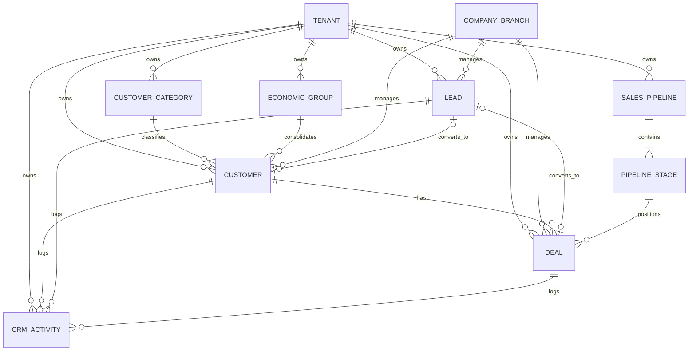
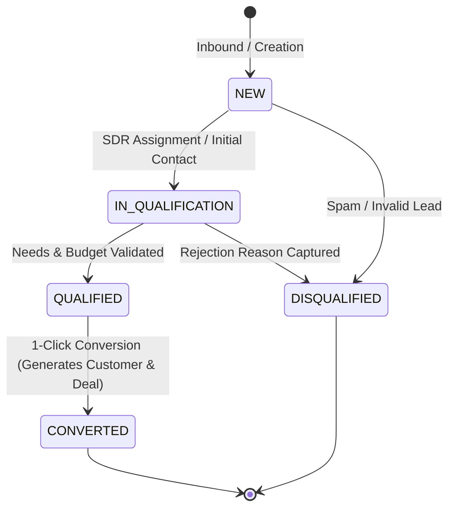
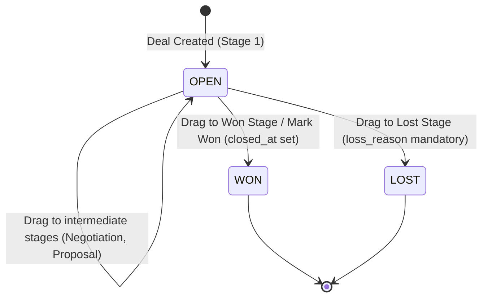

# Data Model: CRM, Customer Master Data, Leads & Sales Pipeline

**Feature Branch**: `007-crm-sales-pipeline`  
**Date**: 2026-11-02  
**Spec Reference**: `specs/007-crm-sales-pipeline/spec.md`  
**Flyway Migration**: `V1_0_10__create_crm_tables.sql`

---

## 1. Entity-Relationship Overview

---

## 2. Entities & Schema Definitions

### 2.1 Customer Categories (`customer_categories`)
Groups customers into commercial segments (e.g., Atacado, Varejo, Distribuidor, Consumidor Final).

| Column | Type | Constraints | Description |
|---|---|---|---|
| `id` | UUID | PK, DEFAULT gen_random_uuid() | Unique identifier |
| `tenant_id` | UUID | NOT NULL | Tenant isolation key |
| `code` | VARCHAR(30) | NOT NULL | Unique category code (e.g., `ATACADO`) |
| `name` | VARCHAR(100) | NOT NULL | Category name |
| `description` | VARCHAR(255) | NULL | Optional description |
| `color_hex` | VARCHAR(7) | DEFAULT '#3B82F6' | Color badge hex code |
| `default_discount_pct` | NUMERIC(5, 2) | DEFAULT 0.00 | Standard category discount |
| `is_active` | BOOLEAN | NOT NULL DEFAULT TRUE | Status flag |
| `created_at` | TIMESTAMPTZ | NOT NULL DEFAULT NOW() | Record creation timestamp |
| `updated_at` | TIMESTAMPTZ | NOT NULL DEFAULT NOW() | Last update timestamp |

**Indexes & Constraints**:
- `UNIQUE (tenant_id, code)`
- `INDEX idx_customer_categories_tenant (tenant_id)`

---

### 2.2 Economic Groups (`economic_groups`)
Represents corporate holdings and conglomerates grouping related customer accounts to calculate consolidated credit limits and revenue exposure.

| Column | Type | Constraints | Description |
|---|---|---|---|
| `id` | UUID | PK, DEFAULT gen_random_uuid() | Unique identifier |
| `tenant_id` | UUID | NOT NULL | Tenant isolation key |
| `code` | VARCHAR(30) | NOT NULL | Unique group code (e.g., `GRP-VOTORANTIM`) |
| `name` | VARCHAR(150) | NOT NULL | Holding company or conglomerate name |
| `holding_cnpj` | VARCHAR(14) | NULL | Root CNPJ of parent holding company |
| `consolidated_credit_limit` | NUMERIC(15, 2) | DEFAULT 0.00 | Max total credit line for entire group |
| `is_active` | BOOLEAN | NOT NULL DEFAULT TRUE | Status flag |
| `created_at` | TIMESTAMPTZ | NOT NULL DEFAULT NOW() | Record creation timestamp |
| `updated_at` | TIMESTAMPTZ | NOT NULL DEFAULT NOW() | Last update timestamp |

**Indexes & Constraints**:
- `UNIQUE (tenant_id, code)`
- `INDEX idx_economic_groups_tenant (tenant_id)`

---

### 2.3 Customers (`customers`)
Master commercial registry supporting both Individuals (Pessoa Física) and Legal Entities (Pessoa Jurídica), incorporating primary, billing, and delivery address structures.

| Column | Type | Constraints | Description |
|---|---|---|---|
| `id` | UUID | PK, DEFAULT gen_random_uuid() | Unique customer ID |
| `tenant_id` | UUID | NOT NULL | Tenant isolation key |
| `branch_id` | UUID | NULL REFERENCES company_branches(id) | Associated branch (NULL = global tenant-wide) |
| `type` | VARCHAR(20) | NOT NULL DEFAULT 'LEGAL_ENTITY' | `INDIVIDUAL` (PF) or `LEGAL_ENTITY` (PJ) |
| `document` | VARCHAR(14) | NOT NULL | Unmasked CPF (11) or CNPJ (14), Modulo 11 validated |
| `legal_name` | VARCHAR(150) | NOT NULL | Razão Social (PJ) or Nome Completo (PF) |
| `trade_name` | VARCHAR(150) | NULL | Nome Fantasia (PJ) or Apelido (PF) |
| `state_registration` | VARCHAR(30) | NULL | Inscrição Estadual (IE) or RG for Individual |
| `is_state_registration_exempt` | BOOLEAN | NOT NULL DEFAULT FALSE | Isento de Inscrição Estadual |
| `municipal_registration` | VARCHAR(30) | NULL | Inscrição Municipal (IM) |
| `icms_taxpayer_type` | VARCHAR(30) | NOT NULL DEFAULT 'NON_CONTRIBUTOR' | `CONTRIBUTOR`, `NON_CONTRIBUTOR`, `EXEMPT` |
| `main_cnae` | VARCHAR(20) | NULL | CNAE fiscal activity code |
| `birth_or_founding_date` | DATE | NULL | Data de Nascimento (PF) / Fundação (PJ) |
| `phone_1` | VARCHAR(30) | NULL | Primary contact phone / WhatsApp |
| `phone_2` | VARCHAR(30) | NULL | Secondary contact phone |
| `email` | VARCHAR(100) | NULL | Commercial / invoice contact email |
| `contact_person` | VARCHAR(100) | NULL | Named representative / contact person |
| `website` | VARCHAR(200) | NULL | Corporate website |
| `category_id` | UUID | NULL REFERENCES customer_categories(id) | Assigned customer segment |
| `economic_group_id` | UUID | NULL REFERENCES economic_groups(id) | Associated holding group |
| `credit_limit` | NUMERIC(15, 2) | NOT NULL DEFAULT 0.00 | Approved commercial credit ceiling |
| `credit_status` | VARCHAR(30) | NOT NULL DEFAULT 'APPROVED' | `APPROVED`, `SUSPENDED`, `BLOCKED` |
| `notes` | TEXT | NULL | General internal notes |
| `is_active` | BOOLEAN | NOT NULL DEFAULT TRUE | Status flag |
| **Primary Address** | | | |
| `postal_code` | VARCHAR(10) | NULL | CEP (e.g., `01310100`) |
| `street` | VARCHAR(150) | NULL | Logradouro / Rua |
| `number` | VARCHAR(30) | NULL | Número |
| `complement` | VARCHAR(100) | NULL | Complemento |
| `neighborhood` | VARCHAR(100) | NULL | Bairro |
| `city_name` | VARCHAR(100) | NULL | Nome do Município |
| `city_ibge_code` | INTEGER | NULL | Código IBGE do Município (7 dígitos) |
| `state_code` | VARCHAR(2) | NULL | Sigla da UF (e.g., `SP`, `RJ`) |
| `country_code` | VARCHAR(3) | NOT NULL DEFAULT 'BRA' | Código do País (ISO Alpha-3) |
| **Billing Address (Cobrança/Pagamento)** | | | (Optional, legacy `EnderecoCliForPag`) |
| `billing_postal_code` | VARCHAR(10) | NULL | CEP Cobrança |
| `billing_street` | VARCHAR(150) | NULL | Logradouro Cobrança |
| `billing_number` | VARCHAR(30) | NULL | Número Cobrança |
| `billing_complement` | VARCHAR(100) | NULL | Complemento Cobrança |
| `billing_neighborhood` | VARCHAR(100) | NULL | Bairro Cobrança |
| `billing_city_name` | VARCHAR(100) | NULL | Cidade Cobrança |
| `billing_state_code` | VARCHAR(2) | NULL | UF Cobrança |
| **Delivery Address (Entrega)** | | | (Optional, legacy `EnderecoCliForEnt`) |
| `delivery_postal_code` | VARCHAR(10) | NULL | CEP Entrega |
| `delivery_street` | VARCHAR(150) | NULL | Logradouro Entrega |
| `delivery_number` | VARCHAR(30) | NULL | Número Entrega |
| `delivery_complement` | VARCHAR(100) | NULL | Complemento Entrega |
| `delivery_neighborhood` | VARCHAR(100) | NULL | Bairro Entrega |
| `delivery_city_name` | VARCHAR(100) | NULL | Cidade Entrega |
| `delivery_state_code` | VARCHAR(2) | NULL | UF Entrega |
| **Audit Columns** | | | |
| `created_at` | TIMESTAMPTZ | NOT NULL DEFAULT NOW() | Creation timestamp |
| `updated_at` | TIMESTAMPTZ | NOT NULL DEFAULT NOW() | Last update timestamp |

**Indexes & Constraints**:
- `UNIQUE (tenant_id, document)`
- `INDEX idx_customers_tenant (tenant_id)`
- `INDEX idx_customers_branch (branch_id)`
- `INDEX idx_customers_category (category_id)`
- `INDEX idx_customers_economic_group (economic_group_id)`
- `INDEX idx_customers_legal_name (legal_name)`
- `INDEX idx_customers_trade_name (trade_name)`

---

### 2.4 Leads (`leads`)
Tracks prospective customers throughout the top of the commercial funnel.

| Column | Type | Constraints | Description |
|---|---|---|---|
| `id` | UUID | PK, DEFAULT gen_random_uuid() | Unique Lead ID |
| `tenant_id` | UUID | NOT NULL | Tenant isolation key |
| `branch_id` | UUID | NULL REFERENCES company_branches(id) | Associated branch |
| `name` | VARCHAR(150) | NOT NULL | Contact lead name |
| `company_name` | VARCHAR(150) | NULL | Prospective organization name |
| `email` | VARCHAR(100) | NULL | Lead email address |
| `phone` | VARCHAR(30) | NULL | Lead phone or WhatsApp |
| `source` | VARCHAR(50) | NOT NULL DEFAULT 'WEBSITE' | `WEBSITE`, `INBOUND`, `EVENT`, `OUTBOUND`, `REFERRAL`, `SOCIAL_MEDIA`, `OTHER` |
| `status` | VARCHAR(30) | NOT NULL DEFAULT 'NEW' | `NEW`, `IN_QUALIFICATION`, `QUALIFIED`, `DISQUALIFIED`, `CONVERTED` |
| `estimated_budget` | NUMERIC(15, 2) | DEFAULT 0.00 | Estimated budget / potential value |
| `interest_summary` | TEXT | NULL | Product/service interest notes |
| `assigned_user_id` | UUID | NULL REFERENCES users(id) | Assigned sales rep / SDR |
| `disqualification_reason` | VARCHAR(255) | NULL | Reason required when status is `DISQUALIFIED` |
| `converted_customer_id` | UUID | NULL REFERENCES customers(id) | Created customer when converted |
| `converted_deal_id` | UUID | NULL | Created opportunity when converted |
| `created_at` | TIMESTAMPTZ | NOT NULL DEFAULT NOW() | Creation timestamp |
| `updated_at` | TIMESTAMPTZ | NOT NULL DEFAULT NOW() | Last update timestamp |

**Indexes & Constraints**:
- `INDEX idx_leads_tenant (tenant_id)`
- `INDEX idx_leads_status (status)`
- `INDEX idx_leads_assigned_user (assigned_user_id)`

---

### 2.5 Sales Pipelines & Stages (`sales_pipelines`, `pipeline_stages`)
Defines custom sales pipelines and sequential progression stages with win probability and SLA controls.

#### Table: `sales_pipelines`
| Column | Type | Constraints | Description |
|---|---|---|---|
| `id` | UUID | PK, DEFAULT gen_random_uuid() | Unique pipeline ID |
| `tenant_id` | UUID | NOT NULL | Tenant isolation key |
| `code` | VARCHAR(30) | NOT NULL | Pipeline code (e.g., `DEFAULT`, `ENTERPRISE`) |
| `name` | VARCHAR(100) | NOT NULL | Pipeline name (e.g., Funil Padrão) |
| `is_default` | BOOLEAN | NOT NULL DEFAULT FALSE | True if default pipeline for new deals |
| `is_active` | BOOLEAN | NOT NULL DEFAULT TRUE | Status flag |
| `created_at` | TIMESTAMPTZ | NOT NULL DEFAULT NOW() | Creation timestamp |
| `updated_at` | TIMESTAMPTZ | NOT NULL DEFAULT NOW() | Last update timestamp |

**Constraints**:
- `UNIQUE (tenant_id, code)`

#### Table: `pipeline_stages`
| Column | Type | Constraints | Description |
|---|---|---|---|
| `id` | UUID | PK, DEFAULT gen_random_uuid() | Unique stage ID |
| `pipeline_id` | UUID | NOT NULL REFERENCES sales_pipelines(id) ON DELETE CASCADE | Parent pipeline |
| `name` | VARCHAR(100) | NOT NULL | Stage title (e.g., "Proposta Enviada") |
| `order_index` | INTEGER | NOT NULL DEFAULT 0 | Ordering index (0, 1, 2...) |
| `win_probability_pct` | INTEGER | NOT NULL DEFAULT 10 | Forecasting win probability (0-100) |
| `color_hex` | VARCHAR(7) | DEFAULT '#6366F1' | Visual badge color |
| `max_stagnant_days` | INTEGER | DEFAULT 15 | Days before flagging deal as stagnant |
| `stage_type` | VARCHAR(20) | NOT NULL DEFAULT 'IN_PROGRESS' | `IN_PROGRESS`, `WON`, `LOST` |

**Constraints**:
- `INDEX idx_pipeline_stages_pipeline (pipeline_id, order_index)`

---

### 2.6 Deals / Opportunities (`deals`)
Tracks commercial transactions, stage movement, estimated monetary values, and outcomes.

| Column | Type | Constraints | Description |
|---|---|---|---|
| `id` | UUID | PK, DEFAULT gen_random_uuid() | Unique deal ID |
| `tenant_id` | UUID | NOT NULL | Tenant isolation key |
| `branch_id` | UUID | NULL REFERENCES company_branches(id) | Associated branch |
| `pipeline_id` | UUID | NOT NULL REFERENCES sales_pipelines(id) | Current pipeline |
| `stage_id` | UUID | NOT NULL REFERENCES pipeline_stages(id) | Current stage |
| `customer_id` | UUID | NOT NULL REFERENCES customers(id) | Associated customer |
| `lead_id` | UUID | NULL REFERENCES leads(id) | Source lead if converted |
| `title` | VARCHAR(150) | NOT NULL | Deal title (e.g., "Contrato Anual ERP") |
| `estimated_value` | NUMERIC(15, 2) | NOT NULL DEFAULT 0.00 | Monetary value |
| `currency` | VARCHAR(3) | NOT NULL DEFAULT 'BRL' | ISO currency code |
| `expected_close_date` | DATE | NULL | Forecasted close date |
| `status` | VARCHAR(20) | NOT NULL DEFAULT 'OPEN' | `OPEN`, `WON`, `LOST` |
| `loss_reason` | VARCHAR(255) | NULL | Required if `status = 'LOST'` |
| `assigned_user_id` | UUID | NULL REFERENCES users(id) | Deal owner / salesperson |
| `closed_at` | TIMESTAMPTZ | NULL | Timestamp when won or lost |
| `created_at` | TIMESTAMPTZ | NOT NULL DEFAULT NOW() | Creation timestamp |
| `updated_at` | TIMESTAMPTZ | NOT NULL DEFAULT NOW() | Last update timestamp |

**Indexes & Constraints**:
- `INDEX idx_deals_tenant (tenant_id)`
- `INDEX idx_deals_stage (stage_id)`
- `INDEX idx_deals_customer (customer_id)`
- `INDEX idx_deals_assigned_user (assigned_user_id)`
- `INDEX idx_deals_status (status)`

---

### 2.7 CRM Activities & Interactions (`crm_activities`)
Chronological interaction history and tasks linked polymorphically to Customers, Leads, or Deals.

| Column | Type | Constraints | Description |
|---|---|---|---|
| `id` | UUID | PK, DEFAULT gen_random_uuid() | Unique activity ID |
| `tenant_id` | UUID | NOT NULL | Tenant isolation key |
| `entity_type` | VARCHAR(30) | NOT NULL | `CUSTOMER`, `LEAD`, `DEAL` |
| `entity_id` | UUID | NOT NULL | Target entity UUID |
| `activity_type` | VARCHAR(30) | NOT NULL | `NOTE`, `CALL`, `MEETING`, `WHATSAPP`, `TASK` |
| `summary` | VARCHAR(200) | NOT NULL | Activity headline summary |
| `description` | TEXT | NULL | Full activity notes or description |
| `performed_at` | TIMESTAMPTZ | NOT NULL DEFAULT NOW() | Interaction occurrence timestamp |
| `due_date` | TIMESTAMPTZ | NULL | Target deadline if activity is a TASK |
| `is_completed` | BOOLEAN | NOT NULL DEFAULT TRUE | Task completion status |
| `author_user_id` | UUID | NULL REFERENCES users(id) | Author or assignee |
| `created_at` | TIMESTAMPTZ | NOT NULL DEFAULT NOW() | Record creation timestamp |

**Indexes & Constraints**:
- `INDEX idx_crm_activities_target (tenant_id, entity_type, entity_id)`
- `INDEX idx_crm_activities_performed (performed_at DESC)`

---

## 3. State Machines & Lifecycle Transitions

### 3.1 Lead Lifecycle

### 3.2 Deal / Pipeline Lifecycle

