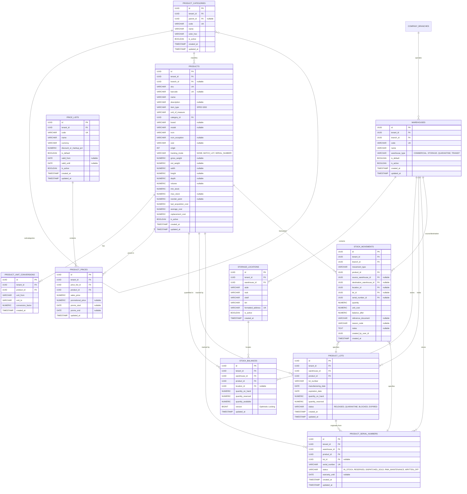

# Data Model: Product Master Data, Brazilian Taxation, Multi-Warehouse Inventory & Traceability

**Feature Branch**: `008-product-inventory-catalog`  
**Date**: 2026-11-07  
**Database**: PostgreSQL 16+ via Flyway migration `V1_0_11__create_product_and_inventory_tables.sql`

---

## 1. Entity-Relationship Diagram

---

## 2. Enumerations

### 2.1 Item Type (`SpedItemType`)
- `REV_00`: Mercadoria para Revenda
- `MP_01`: Matéria-Prima
- `EMB_02`: Embalagem
- `PP_03`: Produto em Processo
- `PA_04`: Produto Acabado
- `SP_05`: Subproduto
- `PI_06`: Produto Intermediário
- `UC_07`: Material de Uso e Consumo
- `AI_08`: Ativo Imobilizado
- `SRV_09`: Serviços
- `OUT_10`: Outros Insumos
- `OUT_99`: Outras

### 2.2 Tracking Mode (`ProductTrackingMode`)
- `NONE`: Standard non-traceable inventory
- `BATCH_LOT`: Batch/lot controlled (requires lot number, manufacturing date, expiry date, FEFO)
- `SERIAL_NUMBER`: Unit-level serial number controlled

### 2.3 Warehouse Type (`WarehouseType`)
- `COMMERCIAL`: Main sales / distribution depot
- `STORAGE`: Long-term / secondary storage warehouse
- `QUARANTINE`: Damaged, inspection, or quarantine stock
- `TRANSIT`: Temporary transit warehouse for inter-branch transfer

### 2.4 Lot Status (`LotStatus`)
- `RELEASED`: Available for commercial dispatch and picking
- `QUARANTINE`: Temporarily held for quality inspection
- `BLOCKED`: Administratively blocked from dispatch
- `EXPIRED`: Passed expiration date (blocked automatically)

### 2.5 Serial Number Status (`SerialNumberStatus`)
- `IN_STOCK`: Physically present and available
- `RESERVED`: Allocated to an open sales order
- `DISPATCHED_SOLD`: Sold and delivered to a customer
- `RMA_MAINTENANCE`: In maintenance or technical warranty evaluation
- `WRITTEN_OFF`: Disposed, discarded, or lost

### 2.6 Stock Movement Type (`StockMovementType`)
- `INBOUND_PURCHASE`: Inbound receipt from supplier invoice
- `OUTBOUND_SALE`: Outbound shipment for customer order
- `TRANSFER_OUT`: Inter-warehouse outbound deduction
- `TRANSFER_IN`: Inter-warehouse inbound addition
- `ADJUSTMENT_INVENTORY`: Manual cycle count correction
- `RETURN_CUSTOMER`: Customer returned goods
- `RETURN_SUPPLIER`: Goods returned to supplier

---

## 3. Database Indexes & Integrity Constraints

1. **Unique Constraints**:
   - `products`: `UNIQUE (tenant_id, sku)`
   - `products`: `UNIQUE (tenant_id, barcode)` WHERE `barcode IS NOT NULL`
   - `product_categories`: `UNIQUE (tenant_id, code)`
   - `warehouses`: `UNIQUE (tenant_id, code)`
   - `storage_locations`: `UNIQUE (warehouse_id, formatted_address)`
   - `stock_balances`: `UNIQUE (warehouse_id, product_id, location_id)`
   - `product_serial_numbers`: `UNIQUE (tenant_id, product_id, serial_number)`
   - `price_lists`: `UNIQUE (tenant_id, code)`
   - `product_prices`: `UNIQUE (price_list_id, product_id)`

2. **Performance Indexes**:
   - `idx_products_tenant_name`: `(tenant_id, name)`
   - `idx_products_ncm`: `(tenant_id, ncm)`
   - `idx_stock_balances_product`: `(tenant_id, product_id)`
   - `idx_lots_product_expiry`: `(product_id, expiration_date ASC)` WHERE `status = 'RELEASED'` (FEFO optimization)
   - `idx_stock_movements_product_created`: `(tenant_id, product_id, created_at DESC)` (Kardex chronological query)
