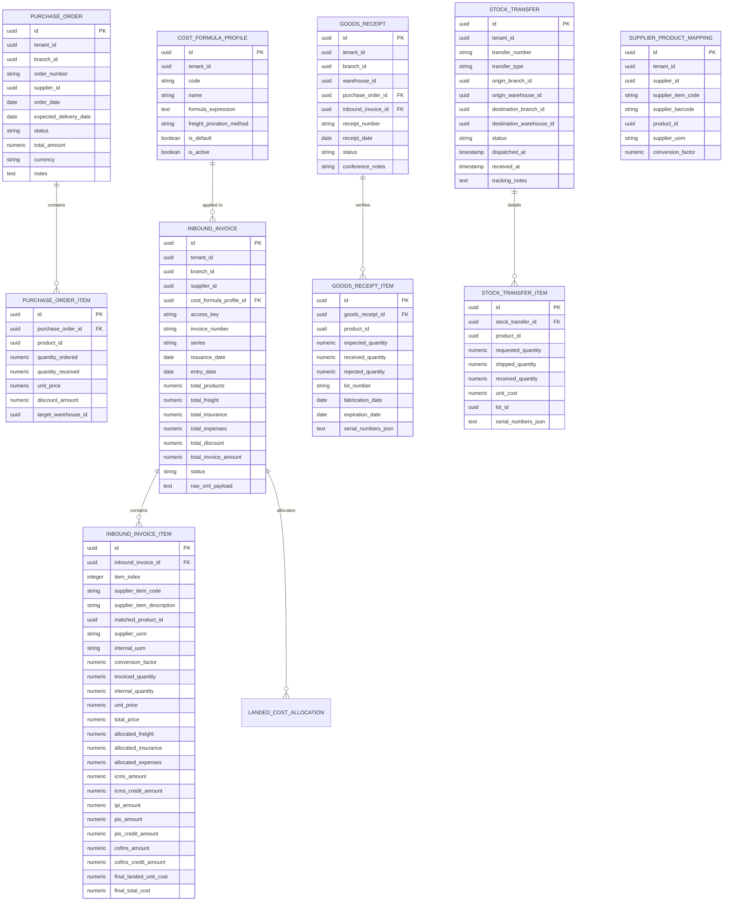

# Data Model: Inbound Purchases, Fiscal Invoicing, Landed Costing & Inventory Transfers

**Feature**: `009-inbound-purchases-transfers`
**Date**: 2026-11-08

---

## Entity Relationship Diagram



---

## Database Schemas & Constraints

### 1. `cost_formula_profiles`
Configurable landed cost formulas (Excel-like dynamic engine).
```sql
CREATE TABLE cost_formula_profiles (
    id UUID PRIMARY KEY DEFAULT gen_random_uuid(),
    tenant_id UUID NOT NULL,
    code VARCHAR(50) NOT NULL,
    name VARCHAR(150) NOT NULL,
    formula_expression TEXT NOT NULL,
    freight_proration_method VARCHAR(30) NOT NULL DEFAULT 'VALUE_PROPORTIONAL', -- 'VALUE_PROPORTIONAL', 'WEIGHT_PROPORTIONAL'
    is_default BOOLEAN NOT NULL DEFAULT FALSE,
    is_active BOOLEAN NOT NULL DEFAULT TRUE,
    created_at TIMESTAMPTZ NOT NULL DEFAULT NOW(),
    updated_at TIMESTAMPTZ NOT NULL DEFAULT NOW(),
    CONSTRAINT uq_cost_profile_tenant_code UNIQUE (tenant_id, code)
);
```

### 2. `supplier_product_mappings`
De-para and conversion factor memory between vendor product codes and internal catalog SKUs.
```sql
CREATE TABLE supplier_product_mappings (
    id UUID PRIMARY KEY DEFAULT gen_random_uuid(),
    tenant_id UUID NOT NULL,
    supplier_id UUID NOT NULL,
    supplier_item_code VARCHAR(100) NOT NULL,
    supplier_barcode VARCHAR(50),
    product_id UUID NOT NULL REFERENCES products(id) ON DELETE RESTRICT,
    supplier_uom VARCHAR(10) NOT NULL DEFAULT 'UN',
    conversion_factor NUMERIC(15, 4) NOT NULL DEFAULT 1.0000,
    created_at TIMESTAMPTZ NOT NULL DEFAULT NOW(),
    updated_at TIMESTAMPTZ NOT NULL DEFAULT NOW(),
    CONSTRAINT uq_supplier_product_mapping UNIQUE (tenant_id, supplier_id, supplier_item_code)
);
```

### 3. `purchase_orders` & `purchase_order_items`
Procurement commercial commitment before goods delivery.
- Status enum: `DRAFT`, `APPROVED`, `PARTIALLY_RECEIVED`, `FULLY_RECEIVED`, `CANCELLED`.

### 4. `inbound_invoices` & `inbound_invoice_items`
NF-e documents and computed landed costs per item.
- Status enum: `DRAFT`, `PENDING_CONFERENCE`, `CONFERRED`, `STOCKED`, `CANCELLED`.

### 5. `goods_receipts` & `goods_receipt_items`
Physical receiving and blind conference records with lot and serial numbers.
- Status enum: `IN_PROGRESS`, `CONFERRED_OK`, `CONFERRED_WITH_DIVERGENCE`, `CANCELLED`.

### 6. `stock_transfers` & `stock_transfer_items`
Internal warehouse and inter-branch movements.
- Transfer Type: `INTERNAL_WAREHOUSE`, `INTER_BRANCH`.
- Status enum: `DRAFT`, `DISPATCHED_IN_TRANSIT`, `RECEIVED_COMPLETED`, `CANCELLED`.
