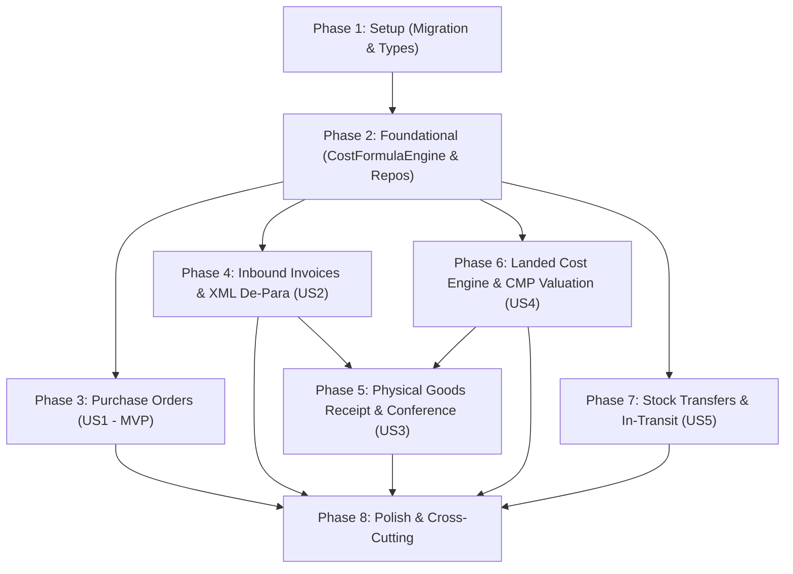

# Tasks: Inbound Purchases, Fiscal Invoicing, Landed Costing & Inventory Transfers

**Input**: Design documents from `specs/009-inbound-purchases-transfers/` (`spec.md`, `plan.md`, `research.md`, `data-model.md`, `contracts/inbound-api.yaml`, `quickstart.md`)

**Prerequisites**: `plan.md`, `spec.md`, `data-model.md`, `contracts/inbound-api.yaml`

**Organization**: Tasks are grouped by foundational infrastructure and user stories to enable independent implementation and testing of each story.

## Format: `- [ ] [ID] [P?] [Story] Description with file path`

- **[P]**: Can run in parallel (different files, no dependencies)
- **[Story]**: Which user story this task belongs to (`[US1]`, `[US2]`, `[US3]`, `[US4]`, `[US5]`)

---

## Phase 1: Setup (Shared Infrastructure)

**Purpose**: Database schema creation, frontend API contracts, and foundational types.

- [ ] T001 Create database Flyway migration script in `backend/src/main/resources/db/migration/V1_0_12__create_inbound_and_transfer_tables.sql` with tables `cost_formula_profiles`, `supplier_product_mappings`, `purchase_orders`, `purchase_order_items`, `inbound_invoices`, `inbound_invoice_items`, `goods_receipts`, `goods_receipt_items`, `stock_transfers`, and `stock_transfer_items`.
- [ ] T002 [P] Define TypeScript interfaces and types for purchase orders, invoices, formula profiles with custom variables, receipts, and transfers in `frontend/src/types/inbound.ts`.
- [ ] T003 [P] Create frontend API service client covering all inbound REST endpoints in `frontend/src/services/inboundApi.ts`.

---

## Phase 2: Foundational (Blocking Prerequisites)

**Purpose**: Core calculation engine, formula evaluator, and base repositories that subsequent user stories depend on.

- [ ] T004 Implement Excel-like formula evaluator `CostFormulaEngine` with sandboxed SpEL expression evaluation, custom variables injection, and mathematical functions (`ROUND`, `IF`, `MAX`, `MIN`, `COALESCE`) in `backend/src/main/kotlin/org/opencontrol/erp/inbound/domain/CostFormulaEngine.kt`.
- [ ] T005 [P] Create unit tests for `CostFormulaEngine` verifying arithmetic, custom variables, precedence, division by zero handling, and conditional logic in `backend/src/test/kotlin/org/opencontrol/erp/inbound/domain/CostFormulaEngineTest.kt`.
- [ ] T006 [P] Create Spring Data JPA repositories `CostFormulaProfileRepository`, `PurchaseOrderRepository`, `InboundInvoiceRepository`, `SupplierProductMappingRepository`, `GoodsReceiptRepository`, and `StockTransferRepository` in `backend/src/main/kotlin/org/opencontrol/erp/inbound/repository/InboundRepositories.kt`.

**Checkpoint**: Foundation ready - User stories can now be implemented and tested independently.

---

## Phase 3: User Story 1 - Purchase Orders to Suppliers (Priority: P1) 🎯 MVP

**Goal**: Enable purchasing agents to create, approve, and track purchase orders to suppliers with item lines, agreed costs, and target delivery warehouses.

**Independent Test**: Create a purchase order with multiple items, approve it via API/UI, and verify status transitions to `APPROVED` with correct gross totals and fulfillment metrics.

### Tests for User Story 1

- [ ] T007 [P] [US1] Create unit tests for purchase order lifecycle (Draft, Approved, Cancelled, tracking quantities) in `backend/src/test/kotlin/org/opencontrol/erp/inbound/service/PurchaseOrderServiceTest.kt`.
- [ ] T008 [P] [US1] Create controller unit test for `PurchaseOrderController` endpoints in `backend/src/test/kotlin/org/opencontrol/erp/inbound/api/PurchaseOrderControllerTest.kt`.

### Implementation for User Story 1

- [ ] T009 [P] [US1] Implement JPA domain models `PurchaseOrder` and `PurchaseOrderItem` in `backend/src/main/kotlin/org/opencontrol/erp/inbound/domain/model/PurchaseOrder.kt`.
- [ ] T010 [P] [US1] Create DTOs `CreatePurchaseOrderRequest`, `PurchaseOrderResponse`, and `PurchaseOrderItemResponse` in `backend/src/main/kotlin/org/opencontrol/erp/inbound/api/dto/PurchaseOrderDtos.kt`.
- [ ] T011 [US1] Implement `PurchaseOrderService` with creation, item totals calculation, status state transitions, and audit logging in `backend/src/main/kotlin/org/opencontrol/erp/inbound/service/PurchaseOrderService.kt`.
- [ ] T012 [US1] Implement REST controller `PurchaseOrderController` with search, get by id, create, approve, and cancel in `backend/src/main/kotlin/org/opencontrol/erp/inbound/api/PurchaseOrderController.kt`.
- [ ] T013 [P] [US1] Build Purchase Order creation modal `PurchaseOrderModal.tsx` in `frontend/src/components/inbound/PurchaseOrderModal.tsx` with auto-generated order codes, supplier search, item selector, and delivery warehouse.
- [ ] T014 [US1] Build Purchase Orders list page `PurchaseOrdersPage.tsx` in `frontend/src/pages/inbound/PurchaseOrdersPage.tsx` with status badges, metrics, and approval action.

**Checkpoint**: User Story 1 fully functional and testable independently.

---

## Phase 4: User Story 2 - Inbound Fiscal Invoice Entry (NF-e XML & Manual) & Partner/Item Matching (Priority: P1)

**Goal**: Ingest SEFAZ NF-e XML files and manual invoices, extract fiscal metadata, match vendor products to internal SKUs with packaging conversion, and calculate landed costs.

**Independent Test**: Upload an NF-e XML file, match an unmapped supplier item to a catalog SKU with conversion factor (e.g. 1 CX = 12 UN), and verify that invoice line items display correct internal quantities and unit costs.

### Tests for User Story 2

- [ ] T015 [P] [US2] Create unit tests for SEFAZ NF-e XML parser verifying extraction of header, issuer, products, freight, and taxes in `backend/src/test/kotlin/org/opencontrol/erp/inbound/service/NFeXmlParserServiceTest.kt`.
- [ ] T016 [P] [US2] Create unit tests for invoice item matching and de-para persistence in `backend/src/test/kotlin/org/opencontrol/erp/inbound/service/InboundInvoiceServiceTest.kt`.

### Implementation for User Story 2

- [ ] T017 [P] [US2] Implement JPA domain models `InboundInvoice`, `InboundInvoiceItem`, and `SupplierProductMapping` in `backend/src/main/kotlin/org/opencontrol/erp/inbound/domain/model/InboundInvoice.kt`.
- [ ] T018 [P] [US2] Create DTOs `InboundInvoiceResponse`, `InboundInvoiceItemResponse`, `MatchProductRequest`, and `FinalizeInvoiceStockRequest` in `backend/src/main/kotlin/org/opencontrol/erp/inbound/api/dto/InboundInvoiceDtos.kt`.
- [ ] T019 [US2] Implement `NFeXmlParserService` to parse SEFAZ NF-e XML (Layout 4.00) using Jackson XML in `backend/src/main/kotlin/org/opencontrol/erp/inbound/service/NFeXmlParserService.kt`.
- [ ] T020 [US2] Implement `InboundInvoiceService` handling XML upload, supplier de-para lookup/creation, packaging unit conversion, and invoice state lifecycle in `backend/src/main/kotlin/org/opencontrol/erp/inbound/service/InboundInvoiceService.kt`.
- [ ] T021 [US2] Implement `InboundInvoiceController` with XML upload, manual creation, item matching, and finalize endpoints in `backend/src/main/kotlin/org/opencontrol/erp/inbound/api/InboundInvoiceController.kt`.
- [ ] T022 [P] [US2] Create NF-e XML upload and item matching modal `NFeXmlUploadModal.tsx` in `frontend/src/components/inbound/NFeXmlUploadModal.tsx`.
- [ ] T023 [US2] Build Inbound Invoices management page `InboundInvoicesPage.tsx` in `frontend/src/pages/inbound/InboundInvoicesPage.tsx` displaying invoices, tax breakdowns, and matching status.

**Checkpoint**: User Stories 1 and 2 work independently and integrate seamlessly.

---

## Phase 5: User Story 3 - Physical Goods Receipt, Blind Conference & Lot/Serial Capture (Priority: P2)

**Goal**: Execute warehouse physical conference of incoming shipments, recording batch lots (with fabrication/expiration dates) and individual serial numbers while catching delivery discrepancies.

**Independent Test**: Conduct a physical conference for an invoice with lot and serial products, verify that discrepancies are flagged, and confirm that lots and serial numbers are saved.

### Tests for User Story 3

- [ ] T024 [P] [US3] Create unit tests for physical conference and divergence detection in `backend/src/test/kotlin/org/opencontrol/erp/inbound/service/GoodsReceiptServiceTest.kt`.

### Implementation for User Story 3

- [ ] T025 [P] [US3] Implement JPA domain models `GoodsReceipt` and `GoodsReceiptItem` in `backend/src/main/kotlin/org/opencontrol/erp/inbound/domain/model/GoodsReceipt.kt`.
- [ ] T026 [P] [US3] Create DTOs `GoodsReceiptResponse`, `SubmitConferenceRequest`, and `GoodsReceiptItemDto` in `backend/src/main/kotlin/org/opencontrol/erp/inbound/api/dto/GoodsReceiptDtos.kt`.
- [ ] T027 [US3] Implement `GoodsReceiptService` for blind/assisted receiving conference, lot validation, serial validation, and divergence reporting in `backend/src/main/kotlin/org/opencontrol/erp/inbound/service/GoodsReceiptService.kt`.
- [ ] T028 [US3] Implement `GoodsReceiptController` in `backend/src/main/kotlin/org/opencontrol/erp/inbound/api/GoodsReceiptController.kt`.
- [ ] T029 [P] [US3] Create Goods Receipt Conference modal `GoodsReceiptModal.tsx` in `frontend/src/components/inbound/GoodsReceiptModal.tsx` supporting lot entry, serial number scanning, and discrepancy counters.

**Checkpoint**: Physical receiving and traceability verification fully operational.

---

## Phase 6: User Story 4 - Landed Cost Calculation with Excel-Like Formulas & Inventory Valuation (CMP) (Priority: P2)

**Goal**: Provide an extensible Excel-like formula engine with user-defined custom variables, prorated freight/insurance, branch tax credit deduction, and automatic statutory CMP inventory updates.

**Independent Test**: Configure a custom formula with custom variables (e.g. `TAXA_DESCARGA = 20.00`), finalize an invoice, and verify that item landed unit costs and new CMP match the formula and RIR Decreto 9.580/2018.

### Tests for User Story 4

- [ ] T030 [P] [US4] Create unit tests for custom formula profiles with user-defined variables and proration methods in `backend/src/test/kotlin/org/opencontrol/erp/inbound/service/CostFormulaServiceTest.kt`.
- [ ] T031 [P] [US4] Create unit tests verifying statutory CMP recalculation and double-entry `stock_movements` postings upon invoice finalization in `backend/src/test/kotlin/org/opencontrol/erp/inbound/service/InventoryValuationTest.kt`.

### Implementation for User Story 4

- [ ] T032 [P] [US4] Implement JPA domain model `CostFormulaProfile` with `custom_variables` JSONB in `backend/src/main/kotlin/org/opencontrol/erp/inbound/domain/model/CostFormulaProfile.kt`.
- [ ] T033 [P] [US4] Create DTOs `CostFormulaProfileResponse`, `CreateCostFormulaProfileRequest`, `EvaluateFormulaTestRequest`, and `EvaluateFormulaTestResponse` in `backend/src/main/kotlin/org/opencontrol/erp/inbound/api/dto/CostFormulaDtos.kt`.
- [ ] T034 [US4] Implement `CostFormulaService` for managing profiles, evaluating formulas with user-defined custom variables, prorating freight/insurance by value or weight, applying branch tax credits, and updating product CMP in `backend/src/main/kotlin/org/opencontrol/erp/inbound/service/CostFormulaService.kt`.
- [ ] T035 [US4] Implement `CostFormulaProfileController` in `backend/src/main/kotlin/org/opencontrol/erp/inbound/api/CostFormulaProfileController.kt`.
- [ ] T036 [P] [US4] Create interactive Landed Cost Simulator modal `LandedCostSimulatorModal.tsx` in `frontend/src/components/inbound/LandedCostSimulatorModal.tsx` allowing users to test formula expressions and custom variable values in real time.
- [ ] T037 [US4] Build Cost Formulas management page `CostFormulasPage.tsx` in `frontend/src/pages/inbound/CostFormulasPage.tsx` with formula editor, custom variable definitions manager, and formula syntax guide.

**Checkpoint**: Dynamic landed costing and statutory inventory valuation fully integrated.

---

## Phase 7: User Story 5 - Internal Warehouse & Inter-Branch Transfers (Priority: P3)

**Goal**: Support internal warehouse transfers and inter-branch transfers with real-time in-transit stock control and lot/serial number preservation.

**Independent Test**: Dispatch an inter-branch transfer of lot-controlled goods from Branch A to Branch B, verify that Branch A stock decrements into "In-Transit", and upon receipt at Branch B, destination stock is credited with identical lots.

### Tests for User Story 5

- [ ] T038 [P] [US5] Create unit tests for internal transfer and inter-branch transfer state machine (Dispatch -> In-Transit -> Receive) in `backend/src/test/kotlin/org/opencontrol/erp/inbound/service/StockTransferServiceTest.kt`.
- [ ] T039 [P] [US5] Create controller test for `StockTransferController` in `backend/src/test/kotlin/org/opencontrol/erp/inbound/api/StockTransferControllerTest.kt`.

### Implementation for User Story 5

- [ ] T040 [P] [US5] Implement JPA domain models `StockTransfer` and `StockTransferItem` in `backend/src/main/kotlin/org/opencontrol/erp/inbound/domain/model/StockTransfer.kt`.
- [ ] T041 [P] [US5] Create DTOs `StockTransferResponse`, `StockTransferItemResponse`, and `CreateTransferRequest` in `backend/src/main/kotlin/org/opencontrol/erp/inbound/api/dto/StockTransferDtos.kt`.
- [ ] T042 [US5] Implement `StockTransferService` handling internal immediate transfer, inter-branch dispatch (`TRANSFER_OUT`), in-transit tracking, and destination receipt (`TRANSFER_IN`) in `backend/src/main/kotlin/org/opencontrol/erp/inbound/service/StockTransferService.kt`.
- [ ] T043 [US5] Implement `StockTransferController` in `backend/src/main/kotlin/org/opencontrol/erp/inbound/api/StockTransferController.kt`.
- [ ] T044 [P] [US5] Create Stock Transfer modal `TransferOrderModal.tsx` in `frontend/src/components/inbound/TransferOrderModal.tsx` supporting branch/warehouse selection, product picking, and lot assignment.
- [ ] T045 [US5] Build Stock Transfers page `StockTransfersPage.tsx` in `frontend/src/pages/inbound/StockTransfersPage.tsx` with tabs for Internal Transfers and Inter-Branch Transfers with In-Transit status tracking.

**Checkpoint**: Multi-warehouse and multi-branch transfer workflows fully functional.

---

## Phase 8: Polish & Cross-Cutting Concerns

**Purpose**: Navigation integration, permission controls, build verification, and end-to-end tests.

- [ ] T046 [P] Update frontend sidebar navigation in `frontend/src/components/layout/Sidebar.tsx` and App routes in `frontend/src/App.tsx` adding links to Pedidos de Compra, Entrada de NF-e, Fórmulas de Custo, and Transferências de Estoque.
- [ ] T047 Run full backend test suite (`./backend/gradlew.bat test jacocoTestReport`) and verify JaCoCo coverage meets $\ge 90\%$ minimum gate.
- [ ] T048 [P] Run frontend test suite (`npm run test --prefix frontend`) and production build (`npm run build --prefix frontend`).
- [ ] T049 Execute end-to-end verification scenario per `quickstart.md`.

---

## Dependencies & Execution Order

### Parallel Opportunities

- **Setup Phase**: T002 and T003 can be built in parallel while T001 is being authored.
- **Foundational Phase**: T005 and T006 can run in parallel once T004 is defined.
- **User Story 1**: T007, T008, T009, T010, and T013 can be developed concurrently before assembling in T011, T012, and T014.
- **User Story 2**: T015, T016, T017, T018, and T022 can run in parallel.
- **User Story 4**: T030, T031, T032, T033, and T036 can run in parallel.
- **User Story 5**: T038, T039, T040, T041, and T044 can run in parallel.
- **Final Polish**: T046, T047, and T048 can run in parallel.

---

## Implementation Strategy

### MVP First (User Story 1 & 2)
1. Complete **Phase 1 (Setup)** and **Phase 2 (Foundational)**.
2. Complete **Phase 3 (User Story 1 - Purchase Orders)**: Provides immediate procurement management value.
3. Complete **Phase 4 (User Story 2 - Inbound Fiscal Invoicing)**: Enables uploading NF-e XML, partner identification, and product de-para.
4. Complete **Phase 6 (User Story 4 - Landed Cost Formula Engine with Custom Variables)**: Empowers companies to calculate custom acquisition costs and update stock balances.
5. Complete **Phase 5 (User Story 3 - Conference & Traceability)** and **Phase 7 (User Story 5 - Transfers)**: Completes the advanced warehouse and multi-branch logistics lifecycle.
